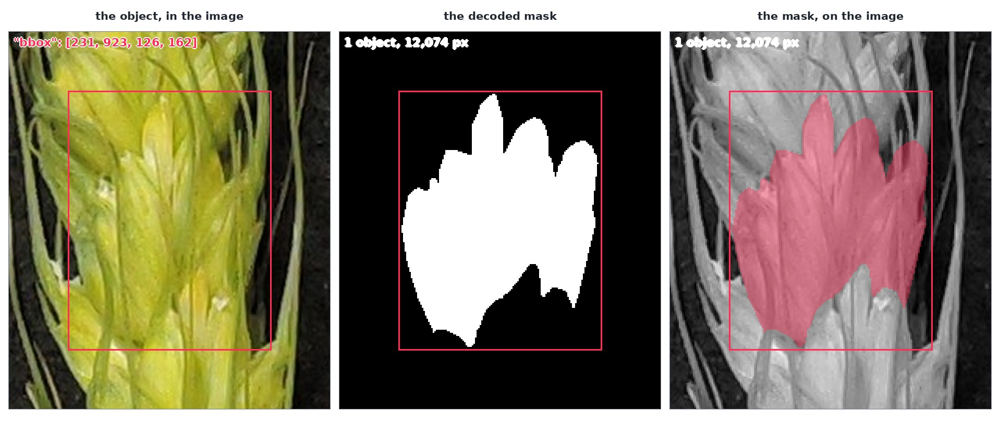

# Clients

Every call in this guide is one HTTP request, and the smallest of them needs nothing but `curl`:

```bash
curl -s -H "X-API-Key: $KEY" "$API/datasets"
```

That is the whole contract — a key in one header, JSON in and JSON out — and the [reference](../interactive.md)
lists every route. What it does not do is get you from an address to pixels. That takes a call to
resolve `(dataset, row)`, a second to fetch the object from `data.*`, a cursor to walk a result
larger than one page, and a compressed `rle.counts` string before a mask is a mask.

So each of the site's three languages ships a **client**: one file, downloaded rather than installed,
with those four things done for you. It carries no response models of its own — every answer is the
API's own JSON — so it cannot disagree with the server; it only saves you the plumbing.

| language | file | what else you need |
|---|---|---|
| Python | `global_wheat.py` | `numpy` and `requests` |
| JavaScript | `global-wheat.js` | nothing |
| Java | `GlobalWheat.java` | nothing — it is one `javac`, and it runs unchanged on Android |

## Load it

=== "Python"

    ```bash
    curl -O https://docs.global-wheat.com/clients/global_wheat.py
    ```

    ```python
    import global_wheat
    ```

    Put it beside your notebook, or in Colab `!curl -O` it into the working directory. There is
    nothing to install and no package index involved.

=== "JavaScript"

    ```html
    <script src="https://docs.global-wheat.com/clients/global-wheat.js"></script>
    ```

    ```js
    import {Client} from "https://docs.global-wheat.com/clients/global-wheat.js";
    ```

    Either form: a plain `<script>` leaves `Client`, `ApiError`, `rle_decode`, and `label_masks` on
    `globalThis`, and a module import gives you the same four names.

    **Where it runs matters.** In Node it is the whole surface — every call below works. In a
    browser, `api.global-wheat.com` sends no `access-control-allow-origin`, deliberately: a page on
    another origin cannot call the API, and it should not, because a token in a browser page is a
    token everyone can read. The one browser origin that works is the API's own, which is how the
    [run-a-model page](../models/index.md) is built; anything else goes through your own server.

=== "Java"

    ```bash
    curl -O https://docs.global-wheat.com/clients/GlobalWheat.java
    javac GlobalWheat.java
    ```

    Drop the file into your source tree and call it — no dependency, no build file. On Android,
    declare the `INTERNET` permission and call the client off the main thread, which is where the
    network belongs anyway.

## One key, one variable

The client reads its token from the environment, so nothing has to be pasted into a notebook:

```bash
export GLOBAL_WHEAT_API_KEY="the token your team was given"
```

`Client()` picks that up. `GLOBAL_WHEAT_API` overrides the host, which is only useful while
something is being tested; the default is `https://api.global-wheat.com`.

## What a client has

The names are the same in all three languages, so this is one table rather than three. What differs is
only how a mask is handed to you — a NumPy array, a typed array, or a `Mask` — which
[Reading a result](#reading-a-result) spells out.

| call | what it gives you |
|---|---|
| `Client()` | a connection; key and host from the environment |
| `datasets()` | the directory: one line per dataset |
| `describe(id)` | one dataset's contract, palette included; fetched once and remembered |
| `images(id, limit=…)` | one page of rows, with `next_cursor` |
| `iter_images(id, …)` | every row a filter selects, page by page |
| `image(id, row)` | one row's whole annotation, each object's `mask` decoded |
| `image_bytes(id, row)` | the image itself |
| `mask_bytes(id, row)` | the row's mask image, where the dataset ships one |
| `models()` / `model(id)` | the directory / one model, with the parameters it accepts |
| `predict(id, dataset, row, …)` | run a model on a published row |
| `predict_file(id, file, …)` | run a model on your own photograph |
| `label_masks(pixels, …, id)` | one mask per class, from a palette mask and the dataset's palette |
| `fetch(url)` | any `image_url` or `mask_url` a response carried, with no key sent |
| `ApiError` | one refusal: `status`, `code`, and the API's own `message` |

Filter pairs are ordinary keyword arguments — `images("gwhd", split="train")` — and repeating a key
narrows the result rather than widening it, exactly as the API defines it. A model's parameters are
passed the same way, by their own names, and are forwarded verbatim:
`predict("sam3.1-meta", "gwhd", 0, prompt="wheat head", confidence_threshold=0.5)`.

## One run, end to end

=== "Python"

    ```python
    import global_wheat

    client = global_wheat.Client()

    for dataset in client.datasets():
        print(dataset["id"], dataset["rows"], dataset["geometry"])

    row = client.image("gwhs-temp", 0)                   # masks arrive decoded
    print(row["width"], row["height"], len(row["objects"]))
    print(row["objects"][0]["category"], int(row["objects"][0]["mask"].sum()))

    answer = client.predict("sam3.1-meta", "gwhs-temp", 0, prompt="wheat head")
    print(answer["model"], answer["computed_by"]["machine"], len(answer["objects"]))

    photo = client.image_bytes("gwhd", 0)                # the image itself, from data.*
    print(len(photo), photo[:2])

    with open("photo.jpg", "wb") as file:
        file.write(photo)
    mine = client.predict_file("sam3.1-meta", "photo.jpg", prompt="wheat head")
    print(len(mine["objects"]))
    ```

=== "JavaScript"

    ```js
    import {Client} from "https://docs.global-wheat.com/clients/global-wheat.js";

    const client = new Client();

    for (const dataset of await client.datasets()) {
      console.log(dataset.id, dataset.rows, dataset.geometry);
    }

    const row = await client.image("gwhs-temp", 0);       // masks arrive decoded
    console.log(row.width, row.height, row.objects.length);
    console.log(row.objects[0].category, row.objects[0].mask.data.reduce((a, b) => a + b, 0));

    const answer = await client.predict("sam3.1-meta", "gwhs-temp", 0, {prompt: "wheat head"});
    console.log(answer.model, answer.computed_by?.machine, answer.objects.length);

    const photo = await client.image_bytes("gwhd", 0);    // a Uint8Array
    const uploaded = await client.predict_file("sam3.1-meta", new Blob([photo]), {prompt: "wheat head"});
    console.log(uploaded.objects.length);
    ```

=== "Java"

    ```java
    import java.util.List;
    import java.util.Map;

    GlobalWheat.Client client = new GlobalWheat.Client();

    for (Map<String, Object> dataset : client.datasets()) {
        System.out.println(dataset.get("id") + " " + dataset.get("rows"));
    }

    Map<String, Object> row = client.image("gwhs-temp", 0);      // masks arrive decoded
    List<Map<String, Object>> objects = (List<Map<String, Object>>) row.get("objects");
    GlobalWheat.Mask mask = (GlobalWheat.Mask) objects.get(0).get("mask");
    System.out.println(row.get("width") + "x" + row.get("height") + " " + mask.count());

    Map<String, Object> answer =
            client.predict("sam3.1-meta", "gwhs-temp", 0, Map.of("prompt", "wheat head"));
    System.out.println(answer.get("model") + " " + answer.get("computed_by"));

    byte[] photo = client.image_bytes("gwhd", 0);                 // the image itself
    Map<String, Object> uploaded =
            client.predict_file("sam3.1-meta", photo, "photo.jpg", Map.of("prompt", "wheat head"));
    System.out.println(((List<?>) uploaded.get("objects")).size());
    ```

## Reading a result

### An object's mask

An instance dataset does not ship a mask image. Each object carries its geometry as COCO's compressed
run-length string, and the client decodes it as the answer arrives, so `mask` is already there:

```json
{ "idx": 0, "category": "spikelet_-_side1", "bbox": [231.0, 923.0, 126.0, 162.0],
  "area": 12074.0, "attributes": ["Green-Spikelet"],
  "rle": { "size": [2509, 592], "counts": "Zofa05S…" } }
```

`rle.size` is `[height, width]`, and `rle.counts` is that object's compressed string, verbatim — the
same format a hosted model answers with, so one decoder reads ground truth and prediction alike. The
raw `rle` stays beside the decoded `mask`, which is what makes the answer checkable: the mask's pixel
count is the `area` the response reports, and that is the cheapest proof that a mask is right.



What the client hands you differs only in container: a `(height, width)` NumPy array in Python, a
row-major `{data, width, height}` in JavaScript, a `Mask` with a row-major `boolean[]` in Java. COCO
flattens masks column-major, and every one of them is transposed once so `mask[y][x]` — or
`data[y * width + x]` — is the pixel at `(x, y)`.

Two answers deserve reading rather than trusting: `resolution_used` is the square side the model
actually ran at, so a mask computed at 1008 and mapped back onto a 2509-pixel-tall photograph is
coarse at full size; and `computed_by` names the machine, which is what explains a boundary that
differs by a pixel between two calls.

### A palette mask, one mask per class

A semantic dataset is the other way round: one mask image, three channels, every pixel one of the
colours the dataset publishes. `label_masks` splits it into one mask per class, using the palette from
`describe` — never a colour copied from a figure.


Split by colour and each class becomes its own mask:


`head` is empty in this row, which is a fact about the image rather than a mistake: the description's
own statistics say the row holds `stem` and `leaf`. A colour the dataset never declared is refused
rather than labelled silently.

The pixels have to be readable, which is why there are two tabs here and not three: `data.*` sends no
CORS header, so a browser can **show** a mask image but cannot read its pixels back. In Node the bytes
arrive (`mask_bytes`) and the pixels are yours to decode; a page served by the API's own origin is the
one browser case where a canvas can be read.

=== "Python"

    ```python
    from io import BytesIO

    import numpy as np
    from PIL import Image

    mask = np.asarray(Image.open(BytesIO(client.mask_bytes("gwfss", 0))))
    for name, pixels in client.label_masks(mask, "gwfss").items():
        print(name, int(pixels.sum()))
    # background 146817 · head 0 · stem 1920 · leaf 113407
    ```

=== "Java"

    ```java
    // Android: BitmapFactory.decodeStream fills the same int[] with getPixels; ImageIO is the JVM's.
    byte[] png = client.mask_bytes("gwfss", 0);
    BufferedImage image = ImageIO.read(new ByteArrayInputStream(png));
    int[] pixels = new int[image.getWidth() * image.getHeight()];
    image.getRGB(0, 0, image.getWidth(), image.getHeight(), pixels, 0, image.getWidth());

    for (Map.Entry<String, GlobalWheat.Mask> entry :
            client.label_masks(pixels, image.getWidth(), image.getHeight(), "gwfss").entrySet()) {
        System.out.println(entry.getKey() + " " + entry.getValue().count());
    }
    ```

## When it goes wrong

A refusal is one body, `{"error": {"code": …, "message": …}}`, and every client raises it as one
error carrying the status, the code, and the API's own sentence — `ApiError` in Python and
JavaScript, `GlobalWheat.ApiError` in Java.

| status | code | what it means |
|---|---|---|
| `400` | `invalid_request` | the request's own fault: a row that does not exist, a parameter outside its range, bytes that are not an image. The model's `message` names what it refused. |
| `401` | `invalid_key` | the key is wrong, or missing |
| `404` | `not_found` | no such dataset or model |
| `413` | `payload_too_large` | an upload over 15 MB |
| `429` | `quota_exceeded` | three requests in flight already from this key; nothing was queued |
| `503` | `unavailable` | no machine is answering this model. Safe to retry |
| `504` | `upstream_timeout` | the model took too long. Safe to retry |

Nothing is retried for you: `503` and `504` are worth another call, `400` never is, and a client that
guessed would hide which of the two happened.
