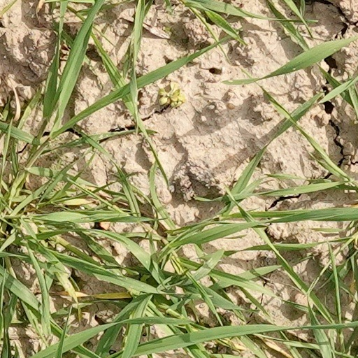
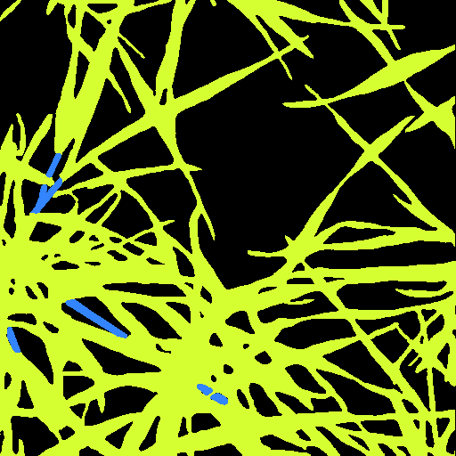
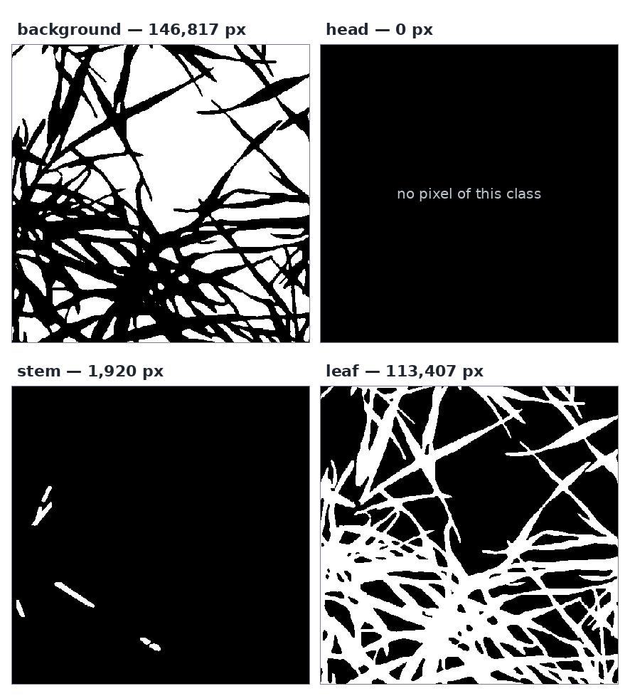

# `gwfss` — Global Wheat Full Semantic Organ Segmentation

|                    the image                     |                    its mask                     |
| :----------------------------------------------: | :---------------------------------------------: |
|  |  |

One row is a 512×512 image plus **a mask image of the same size**, and the mask *is* the annotation:
three channels, one colour per organ, painted in the palette the dataset describes. CC-BY-4.0.

## The response

```json
{
  "dataset": "gwfss", "row": 0, "split": "labelled", "width": 512, "height": 512,
  "image_url": "https://data.global-wheat.com/gwfss/images/00000000.png",
  "mask_url": "https://data.global-wheat.com/gwfss/masks/00000000.png"
}
```

A detail call returns both URLs and no objects, because there are none to return.

## The palette

What the colours mean comes from the dataset's own description — `GET /datasets/gwfss` — and nowhere
else:

| class | colour | in row 0 |
|---|---|---|
| `background` | `#000000` | 146,817 px |
| `head` | `#32ff84` | 0 px |
| `stem` | `#3284ff` | 1,920 px |
| `leaf` | `#d6ff32` | 113,407 px |

In a list response, `statistics.classes` names the classes a row actually contains, so row 0 holds
`stem` and `leaf` — and the zero beside `head` is a fact about the image rather than a gap in the data.

## One mask per class

Splitting the mask image by colour turns each class into its own boolean mask:




`label_masks` does it with the palette from `describe`, never with a colour copied from a figure. A
colour the dataset never declared is refused rather than labelled silently. The pixels have to be
readable, which is why this is a Python-and-Java job on a downloaded file and not a browser page: see
[the quickstart notebook](../examples/quickstart.md) for the split and the counts it prints.

## Get one row

=== "Python"

    ```python
    row = client.image("gwfss", 0)
    ```

=== "JavaScript"

    ```js
    const row = await client.image("gwfss", 0);
    ```

=== "Java"

    ```java
    Map<String, Object> row = client.image("gwfss", 0);
    ```

The annotation is the mask file, so `mask_bytes("gwfss", 0)` is what you decode; `image` is how you
find out which row and which palette.
