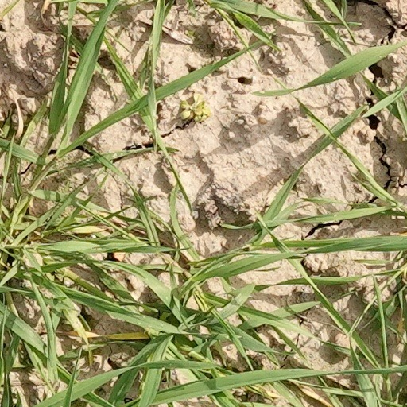
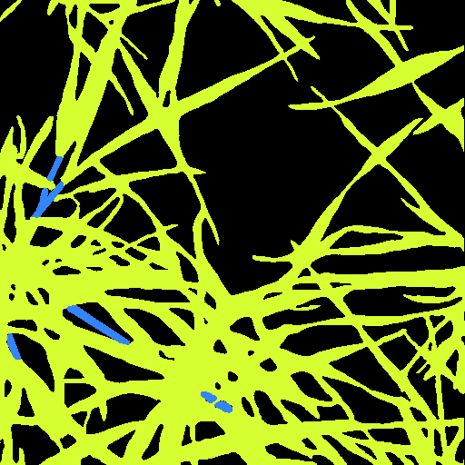
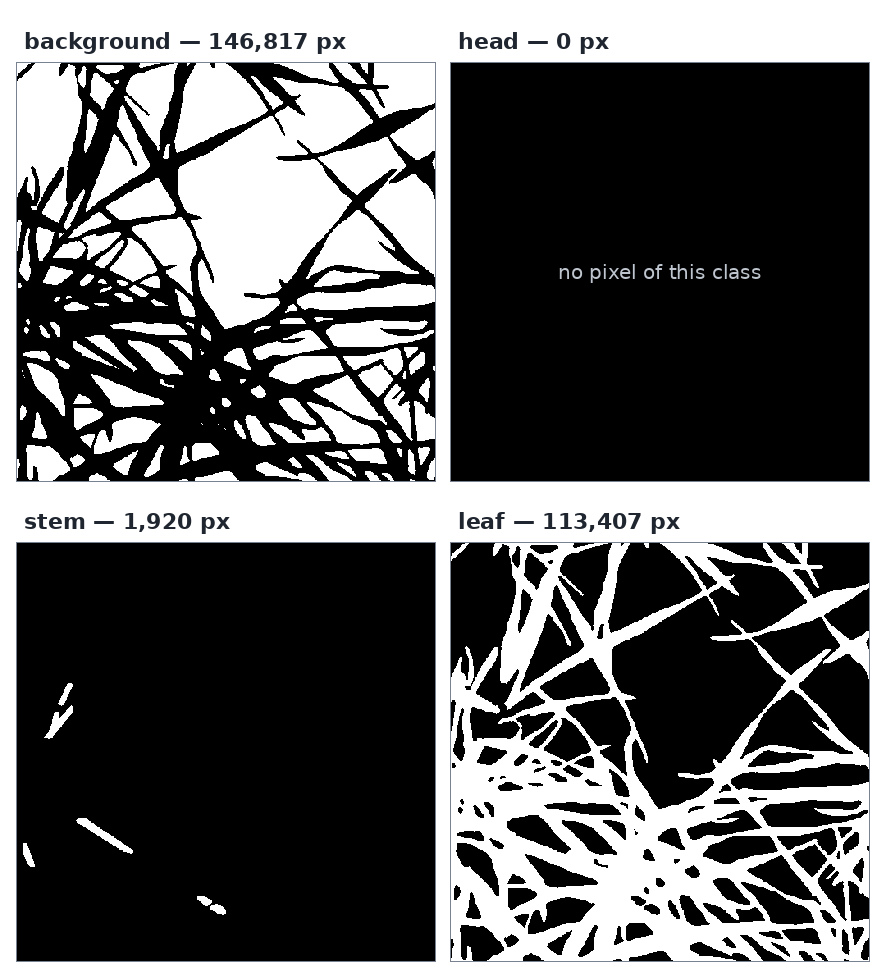

# `gwfss` — Global Wheat Full Semantic Organ Segmentation

Each image carries **a mask image of the same size**, and the mask *is* the annotation: one colour per
organ, painted in the palette the dataset describes. It is the semantic organ dataset: 1,096 labelled
images, published under CC-BY-4.0.

## At a glance

| field | value |
|---|---|
| Task | semantic organ segmentation |
| One image carries | one palette mask image |
| Images | 1,096 |
| Splits | `labelled` |
| Image | 512×512 or 1024×1024; image 0 (`row` 0) is 512×512 |
| Annotation | a palette mask: background, head, stem, leaf |
| Licence | [CC-BY-4.0](#references) |
| Status | published in full |

|                    the image                     |                    its mask                     |
| :----------------------------------------------: | :---------------------------------------------: |
|  |  |

The mask is the annotation, not a second view of the image.

## When to use it

**Good at**

- Labelling every pixel of a wheat canopy as background, head, stem or leaf.
- Training or evaluating a semantic segmentation model with a fixed palette.
- Comparing organ areas across images without writing a decoder for a custom format.

**Not for**

- **Instances.** One class is one mask; there is no object per head. Counting heads is a
  connected-component pass over the `head` class, not a count in the response.
- **Spikelets.** The dataset stops at organs; use [`gwhs`](gwhs.md) for one object per spikelet.
- **Boxes.** The annotation is a mask image; `objects` is not returned.

**Limits**

- The annotation is semantic only; instances require post-processing.
- The mask has the same pixel size as its image; a resolution change has to resize both.
- The licence is CC-BY-4.0.

## Get one image

With the client from [Clients](../api/clients/index.md) set up, or the `API` and `KEY` variables from
[Raw HTTP](../api/http/index.md#five-calls):

=== "Python"

    ```python
    row = client.image("gwfss", 0)
    ```

=== "JavaScript"

    ```js
    const row = await client.image("gwfss", 0);
    ```

=== "Java"

    ```java
    Map<String, Object> row = client.image("gwfss", 0);
    ```

=== "HTTP"

    ```bash
    curl -s -H "X-API-Key: $KEY" "$API/datasets/gwfss/images/0"
    ```

The annotation is the mask file, so `mask_bytes("gwfss", 0)` is what you decode; `image` is how you
find out which image and which palette.

## What one image holds

A detail response carries both addresses and no objects, because the mask image is the annotation:

```json
{
  "dataset": "gwfss", "row": 0, "split": "labelled", "width": 512, "height": 512,
  "image_url": "https://data.global-wheat.com/gwfss/images/00000000.png",
  "mask_url": "https://data.global-wheat.com/gwfss/masks/00000000.png"
}
```

In a list response, `statistics.classes` names the classes an image actually contains, so image 0 (`row` 0) holds
`stem` and `leaf` — and a zero beside `head` would be a fact about the image rather than a gap in the
data.

### Reading the fields

What the colours mean comes from the dataset's own description — `GET /datasets/gwfss` — and nowhere
else:

| class | colour | in image 0 |
|---|---|---|
| `background` | `#000000` | 146,817 px |
| `head` | `#32ff84` | 0 px |
| `stem` | `#3284ff` | 1,920 px |
| `leaf` | `#d6ff32` | 113,407 px |

`mask_url` is a public `data.*` object; it needs no key. `width` and `height` are the image's own
pixels, and the mask has the same size.

## What you can do with it

### Split the palette mask

Splitting the mask image by colour turns each class into its own boolean mask:




`label_masks` does it with the palette from `describe`, never with a colour copied from a figure. A
colour the dataset never declared is refused rather than labelled silently. Python is shown; the
JavaScript and Java clients expose the same method with their own container:

```python
from io import BytesIO

import numpy as np
from PIL import Image

palette = np.asarray(Image.open(BytesIO(client.mask_bytes("gwfss", 0))))
for name, pixels in client.label_masks(palette, "gwfss").items():
    print(f"{name:12s} {int(pixels.sum()):>7d} px")
```

[The quickstart notebook](../examples/quickstart.md) runs the same split and prints the counts.

## References

- **Paper** — Wang et al., “The Global Wheat Full Semantic Organ Segmentation (GWFSS) dataset,”
  Plant Phenomics 2025.
  [doi:10.1016/j.plaphe.2025.100084](https://doi.org/10.1016/j.plaphe.2025.100084)
- **Data** — [GlobalWheat/GWFSS_v1.0](https://huggingface.co/datasets/GlobalWheat/GWFSS_v1.0)
- **Licence** — [CC-BY-4.0](https://creativecommons.org/licenses/by/4.0/)
