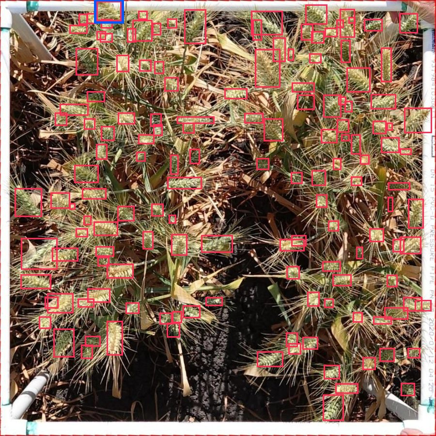
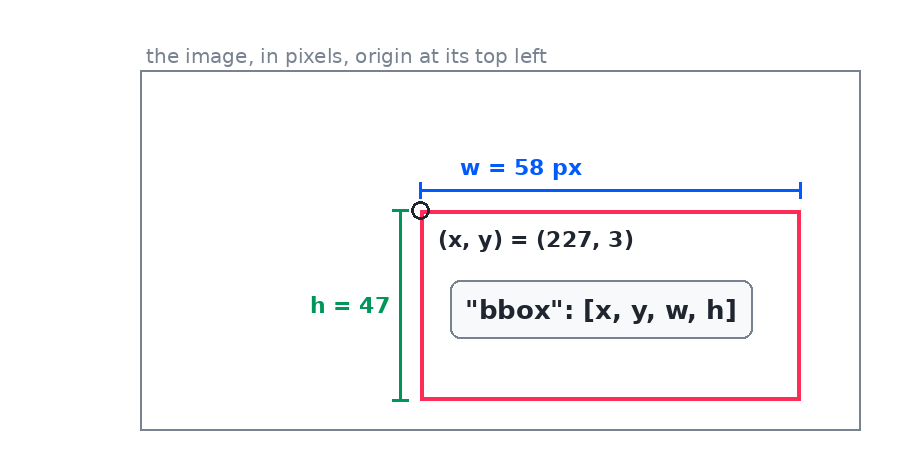

# `gwhd` — Global Wheat Head Detection

Each image is a 1024×1024 plot photograph and carries **one box per wheat head**. It is the classic
detection and counting dataset: 6,512 images across train, validation and test, published under
CC-BY-4.0.

## At a glance

| field | value |
|---|---|
| Task | wheat head detection and counting |
| One image carries | one bounding box per head |
| Images | 6,512 |
| Splits | `train`, `validation`, `test` |
| Image | 1024×1024 |
| Annotation | `bbox` `[x, y, w, h]`; no mask |
| Licence | [CC-BY-4.0](#references) |
| Status | published in full |



Image 0 (`row` 0): a 1024×1024 plot photograph with **one box per wheat head**, 144 of them, drawn here in pink.
The highlighted one is the image's first object.

## When to use it

**Good at**

- Detecting and counting wheat heads in field photographs.
- A benchmark with boxes only: 6,512 images, three splits, one class.
- Training or evaluating a detector without needing masks.

**Not for**

- **Organ masks.** There is no `mask_url` and no RLE; use [`gwfss`](gwfss.md) for pixels.
- **Spikelets.** One box is one head, not one spikelet; use [`gwhs`](gwhs.md) when its annotation is
  released.
- **A second class.** Every box is category `"0"`; the upstream names no head class.

**Limits**

- Boxes have no mask, so a mask-based metric cannot be computed from this dataset.
- Every image is 1024×1024; a different capture has to be resized before comparison.
- The licence is CC-BY-4.0.

## Get one image

With the client from [Clients](../api/clients/index.md) set up, or the `API` and `KEY` variables from
[Raw HTTP](../api/http/index.md#five-calls):

=== "Python"

    ```python
    row = client.image("gwhd", 0)
    ```

=== "JavaScript"

    ```js
    const row = await client.image("gwhd", 0);
    ```

=== "Java"

    ```java
    Map<String, Object> row = client.image("gwhd", 0);
    ```

=== "HTTP"

    ```bash
    curl -s -H "X-API-Key: $KEY" "$API/datasets/gwhd/images/0"
    ```

`image` is the same name in all three clients; what differs is only the container.

## What one image holds

A detail response carries the image's provenance and its boxes:

```json
{
  "dataset": "gwhd", "row": 0, "split": "test", "width": 1024, "height": 1024,
  "image_url": "https://data.global-wheat.com/gwhd/images/00000000.jpg", "mask_url": null,
  "domain": "UQ_9", "country": "Australia", "location": "Brookstead",
  "development_stage": "Filling - Ripening",
  "objects": [
    { "idx": 0, "category": "0", "bbox": [227.0, 3.0, 58.0, 47.0] },
    { "idx": 1, "category": "0", "bbox": [204.0, 31.0, 21.0, 25.0] }
  ]
}
```

A list page reports the same image as `statistics.objects` and never carries the annotation itself.

### Reading the fields

- **`bbox` is `[x, y, w, h]`** in the image's own pixels — top-left corner, then size. Every box is in
  this convention, on every dataset and in every model answer, so one drawing routine covers all of
  them:

  

- **`category` is `"0"`** because the upstream named no head class; the integer is returned as text
  rather than dressed up as a name.
- **`domain`, `country`, `location` and `development_stage`** are the image's provenance, and they are
  exactly the filter keys `GET /datasets/gwhd` publishes beside `split` and `category`.
- **`statistics.objects`** in a list response is how many boxes the image holds — 144 on image 0 (`row` 0) — so you
  can choose images without fetching an annotation.

## What you can do with it

Draw the boxes over the image, or count them. [The quickstart
notebook](../examples/quickstart.md) does both from Python in a few lines; the box convention is the
same one every model answer uses.

## References

- **Paper** — David et al., “Global Wheat Head Detection 2021: An Improved Dataset for Benchmarking
  Wheat Head Detection Methods,” Plant Phenomics 2021.
  [doi:10.34133/2021/9846158](https://doi.org/10.34133/2021/9846158)
- **Data** — [GlobalWheat/GWHD_2021](https://huggingface.co/datasets/GlobalWheat/GWHD_2021)
- **Licence** — [CC-BY-4.0](https://creativecommons.org/licenses/by/4.0/), as declared by the pinned
  dataset card
