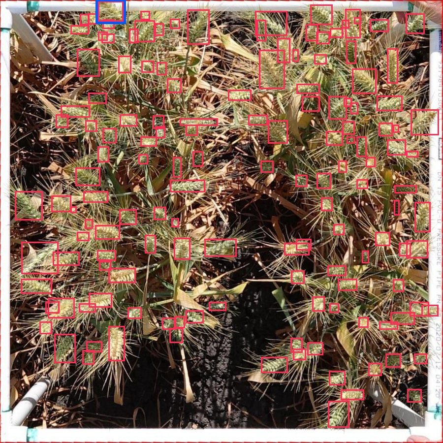
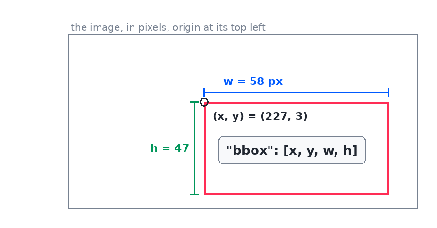

# `gwhd` — Global Wheat Head Detection



Row 0 of the demo set: a 1024×1024 plot photograph with **one box per wheat head**, 144 of them, drawn
here in pink. The highlighted one is the row's first object. CC-BY-4.0.

## The response

```json
{
  "dataset": "gwhd", "row": 0, "split": "test", "width": 1024, "height": 1024,
  "image_url": "https://data.global-wheat.com/gwhd/images/00000000.jpg", "mask_url": null,
  "domain": "UQ_9", "country": "Australia", "location": "Brookstead",
  "development_stage": "Filling - Ripening",
  "objects": [
    { "idx": 0, "category": "0", "bbox": [227.0, 3.0, 58.0, 47.0] },
    { "idx": 1, "category": "0", "bbox": [204.0, 31.0, 21.0, 25.0] }
  ]
}
```

## `bbox`

`bbox` is `[x, y, w, h]` in the image's own pixels — top-left corner, then size. Every box is in this
convention, on every dataset and in every model answer, so one drawing routine covers all of them:



## The fields

- `category` is `"0"` here: the upstream named no head class, so the box is classified by the upstream
  integer, returned as text rather than dressed up as a name.
- `domain`, `country`, `location`, and `development_stage` are the row's provenance, and they are
  exactly the filter keys `GET /datasets/gwhd` publishes beside `split` and `category`.
- Row 0 holds 144 boxes. A list response reports that as `statistics.objects`, so you can choose rows
  by what is in them without fetching an annotation.

## Get one row

=== "Python"

    ```python
    row = client.image("gwhd", 0)
    ```

=== "JavaScript"

    ```js
    const row = await client.image("gwhd", 0);
    ```

=== "Java"

    ```java
    Map<String, Object> row = client.image("gwhd", 0);
    ```

`image` is the same name in all three; what differs is only the container. Drawing the boxes onto the
image is [the notebook's](../examples/notebook.md) job.
