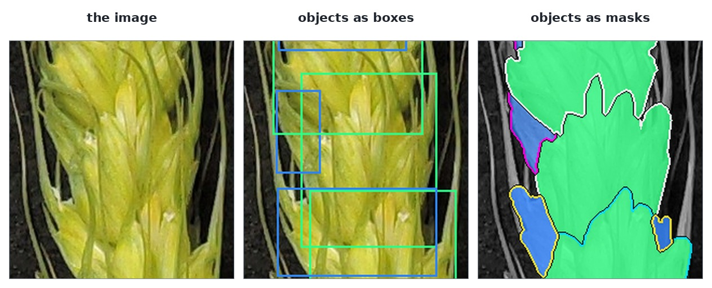
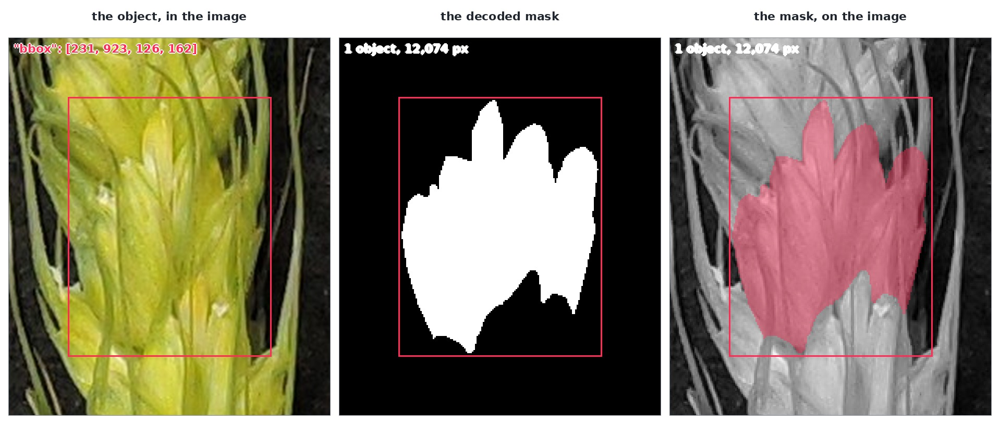

# `gwhs` — Global Wheat Head Segmentation

Each image is a single wheat ear and carries **one object per spikelet**: a box, a COCO RLE mask, an
area and its attributes. The full annotation is not published yet; `gwhs-temp` is the ten-image
development sample with the same schema, and it is what this page uses for its figures and examples. The released
`gwhs` is CC-BY-4.0; the sample's card declares no licence.

## At a glance

| field | value |
|---|---|
| Task | spikelet instance segmentation |
| One image carries | objects: box, RLE mask, area, attributes |
| Images | pending the full annotation; `gwhs-temp` has 10 |
| Splits | pending; the sample is `train` |
| Image | varies; sample image 0 is 592×2509 |
| Annotation | objects with `bbox`, `rle`, `area`, `attributes`; image tags |
| Licence | [CC-BY-4.0](#references) for `gwhs`; the sample declares none |
| Status | not served; `gwhs-temp` is development only |



The figure is an image from `gwhs-temp`: a crop of a 592×2509 photograph of one ear, 24 objects, each with
a box and the mask its geometry decodes to.

## When to use it

**Good at**

- One object per spikelet, with both a box and a mask.
- Counts and sizes per ear, including attributes such as `Green-Spikelet`.
- Close-up photographs of a single ear, where the spikelets are visible.

**Not for**

- **A call today.** `gwhs` is not in `GET /datasets`; a call for one of its images answers `404`.
- **A canopy.** The images are single ears on a desk, not in-field plots; use [`gwfss`](gwfss.md) for
  organ pixels or [`gwhd`](gwhd.md) for head boxes.
- **A released sample.** `gwhs-temp` is for development, declares no licence, and has ten images.

**Limits**

- The full annotation, its image count and its splits are pending.
- The sample is ten images; do not use it for a benchmark or a published result.
- The sample's card declares no licence; the released `gwhs` is CC-BY-4.0.

## Get one image

With the client from [Clients](../api/clients/index.md) set up, or the `API` and `KEY` variables from
[Raw HTTP](../api/http/index.md#five-calls). The full `gwhs` is not served; this call uses
`gwhs-temp`:

=== "Python"

    ```python
    row = client.image("gwhs-temp", 0)
    ```

=== "JavaScript"

    ```js
    const row = await client.image("gwhs-temp", 0);
    ```

=== "Java"

    ```java
    Map<String, Object> row = client.image("gwhs-temp", 0);
    ```

=== "HTTP"

    ```bash
    curl -s -H "X-API-Key: $KEY" "$API/datasets/gwhs-temp/images/0"
    ```

## What one image holds

An image's record carries the shared envelope — dataset, `row`, split, `width`, `height`, `image_url` —
plus `objects` and its tags. One object of `gwhs-temp` image 0 (`row` 0):

```json
{ "idx": 0, "category": "spikelet_-_side1", "bbox": [231.0, 923.0, 126.0, 162.0],
  "area": 12074.0, "attributes": ["Green-Spikelet"],
  "rle": { "size": [2509, 592], "counts": "Zofa05S…" } }
```

Every object carries a box, a **run-length mask**, an area, and its attributes. Where `gwhd` returns
one box per head, this returns one box *and one mask per spikelet*, which is what makes counts and
sizes per spikelet possible.

### Reading the fields

- **`rle.size` is `[height, width]`**, and `rle.counts` is that object's COCO-compressed string,
  verbatim — the same format a hosted model answers with, so one decoder reads ground truth and
  prediction alike.
- **`area` is the decoded mask's pixel count.** The client keeps the raw `rle` beside the `mask`, so
  the mask's pixel count can be checked against the reported area.
- **`attributes`** are the upstream's labels for that spikelet; the image's `tags` are separate.
- **`category`** is the spikelet class, such as `spikelet_-_side1`.

### The container

What the client hands you differs only in the container:

=== "Python"

    ```python
    mask = row["objects"][0]["mask"]        # numpy.ndarray, (height, width), bool
    print(mask.sum())                       # 12074
    ```

=== "JavaScript"

    ```js
    const mask = row.objects[0].mask;       // {data: Uint8Array, width, height}, row-major
    console.log(mask.data.reduce((a, b) => a + b, 0));
    ```

=== "Java"

    ```java
    import java.util.List;
    import java.util.Map;

    List<?> objects = (List<?>) row.get("objects");
    GlobalWheat.Mask mask =
            (GlobalWheat.Mask) ((Map<?, ?>) objects.get(0)).get("mask");
    System.out.println(mask.count());       // a row-major boolean[]
    ```

COCO flattens masks column-major; every one of them is transposed once, by the decoder, so `mask[y][x]`
— or `data[y * width + x]` — is the pixel at `(x, y)`. Nothing in your code transposes anything.

## What you can do with it

Decode the mask and overlay it on the image:



The mask is the size of the image, so compositing it is ordinary array work — the same as a `gwfss`
mask. Counting objects is the length of `objects`; counting spikelets per ear is one object per
spikelet, already separated.

[The quickstart notebook](../examples/quickstart.md) calls the same image and draws the mask.

## References

- **Dataset** — [Global Wheat Head Segmentation](https://www.global-wheat.com/gwhs.html)
- **Sample** — [GlobalWheat/GWHS_v1.0_sample](https://huggingface.co/datasets/GlobalWheat/GWHS_v1.0_sample)
- **Licence** — [CC-BY-4.0](https://creativecommons.org/licenses/by/4.0/) for the released `gwhs`;
  the sample declares no licence.
