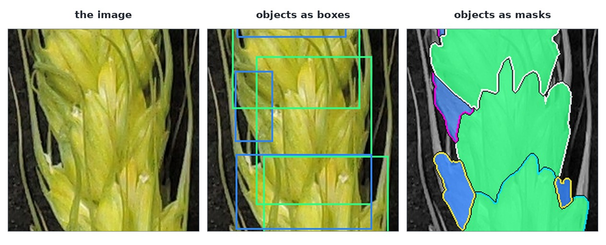

# `gwhs` — Global Wheat Head Segmentation



Not published yet: the full annotation follows the dataset release, so `GET /datasets/gwhs` answers
nothing today. The figure above, and the object below, are a row of `gwhs-temp` — same schema, a crop
of a 592×2509 photograph of one ear, 24 objects, each with a box and the mask its geometry decodes to.
CC-BY-4.0.

## The response

```json
{ "idx": 0, "category": "spikelet_-_side1", "bbox": [231.0, 923.0, 126.0, 162.0],
  "area": 12074.0, "attributes": ["Green-Spikelet"],
  "rle": { "size": [2509, 592], "counts": "Zofa05S…" } }
```

Every object carries a box, a **run-length mask**, an area, and its attributes, and the row carries
its tags. Where `gwhd` returns one box per head, this returns one box *and one mask per spikelet*,
which is what makes counts and sizes per spikelet possible.

## The mask

`rle.size` is `[height, width]`, and `rle.counts` is that object's COCO-compressed string, verbatim —
the same format a hosted model answers with, so one decoder reads ground truth and prediction alike.
Decoding it is not something you write:


The client decodes it as the answer arrives and keeps the raw `rle` beside the `mask`, which is what
makes the answer checkable: the mask's pixel count is the `area` the response reports, and that is the
cheapest proof that a mask is right. `12074` pixels is what `objects[0].mask.sum()` prints for this
object.

## The container

What the client hands you differs only in the container:

=== "Python"

    ```python
    mask = row["objects"][0]["mask"]        # numpy.ndarray, (height, width), bool
    print(mask.sum())                       # 12074
    ```

=== "JavaScript"

    ```js
    const mask = row.objects[0].mask;       // {data: Uint8Array, width, height}, row-major
    console.log(mask.data.reduce((a, b) => a + b, 0));
    ```

=== "Java"

    ```java
    GlobalWheat.Mask mask = (GlobalWheat.Mask) objects.get(0).get("mask");
    System.out.println(mask.count());       // a row-major boolean[]
    ```

COCO flattens masks column-major; every one of them is transposed once, by the decoder, so `mask[y][x]`
— or `data[y * width + x]` — is the pixel at `(x, y)`. Nothing in your code transposes anything.

## Get one row

=== "Python"

    ```python
    row = client.image("gwhs-temp", 0)
    ```

=== "JavaScript"

    ```js
    const row = await client.image("gwhs-temp", 0);
    ```

=== "Java"

    ```java
    Map<String, Object> row = client.image("gwhs-temp", 0);
    ```

Compositing the masks over the image, and running a model on the same row, is
[the quickstart notebook's](../examples/quickstart.md) job.
