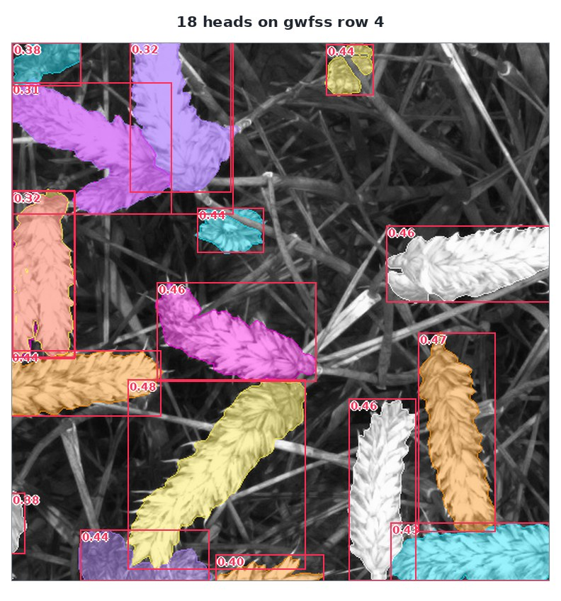

# Live demo

This page runs the model without you installing anything. The panel below is served by
`api.global-wheat.com` and framed here, so it is **same-origin with the API**: no cross-origin call is
involved anywhere, and your key is typed into the API's own page — this site never sees it. The
[reference](../api/reference.md) remembers the same key on the same origin: set it on either page and
the other uses it, Forget on either clears it for both.

## Run one

The panel opens on a model a first-time reader can run with no parameters, and a model's own
**Examples** buttons fill in an address and the parameters a call was measured with — one chip and
Run is the shortest way to a first answer. Nothing is sent until you press it.

The image is drawn as soon as the address is complete — whole, at whatever size the page can show it
in — with each box labelled by the score the model gave it, and the mask decoded in your browser by
the same decoder this site hands you. A class the dataset declares is tinted in the colour that
dataset publishes — the same palette its mask images use — and the legend in the picture's corner
names them. An instance model answers with objects rather than classes, so each of those is given a
colour of its own instead. The model line says how many machines are answering and how long ago the
gateway last asked them, and keeps that age climbing rather than letting a stale count pass for a
live one.

The `results` eye is the layer for whatever a model produces as pixels, in whichever of its two
shapes it takes. A backbone answers with a feature grid, and the first three principal components of
that grid are drawn over the photograph; the `image` eye turns the photograph off so the field is
read on its own. A model that *makes* a picture answers with a PNG, and that picture replaces the
photograph instead of tinting it — the `image` eye is what brings the input back. The colours belong
to that one picture; the [backbone model page](../models/dinov3.md) says what a grid is and what can
be computed from it.

A model that answers in words puts them under the picture, in a bar you can close.

The page also prints the call it would make as a `curl` command, with your key left as `$KEY`, so
anything you set up here can be taken straight to a shell.

<div id="play-frame">
  <iframe
    data-api-frame
    src="https://api.global-wheat.com/play"
    title="Global Wheat API — run one model"
    loading="lazy"
    style="display: block; width: 100%; height: 90vh; border: 0"
  ></iframe>
</div>

## A call we know works

Before the event we ran one call against the pool and kept its answer. Use it as your test case: if
your key and your client reproduce these numbers, both are working, and a difference is the thing to
debug rather than a reason to doubt the whole setup.

| | |
|---|---|
| address | `gwfss`, row `4` — 512×512, cut heads lying on straw |
| model | `sam3.1-meta`, `prompt="wheat head"`, `confidence_threshold=0.25` |
| came back | **18 objects** at `resolution_used` 1008; `Σ mask` = `Σ area` = **109,419 px** |

=== "Python"

    ```python
    answer = client.predict(
        "sam3.1-meta", "gwfss", 4, prompt="wheat head", confidence_threshold=0.25
    )
    ```

=== "JavaScript"

    ```js
    const answer = await client.predict("sam3.1-meta", "gwfss", 4, {
      prompt: "wheat head", confidence_threshold: 0.25,
    });
    ```

=== "Java"

    ```java
    Map<String, Object> answer = client.predict("sam3.1-meta", "gwfss", 4,
            Map.of("prompt", "wheat head", "confidence_threshold", 0.25));
    ```



Every mask's pixel count equals the `area` the answer reports, so the decode is checkable without
looking at the picture: sum the masks and compare with the `area` fields.

The object count and the boxes are what an answer is really about. The pixel counts are **one machine's**
— `computed_by` in this answer names `lab-3090` — and the same call on another card can differ by a
pixel, by a percent of a mask's area, or by one object at the margin. That field is what makes the two
answers comparable rather than contradictory.
