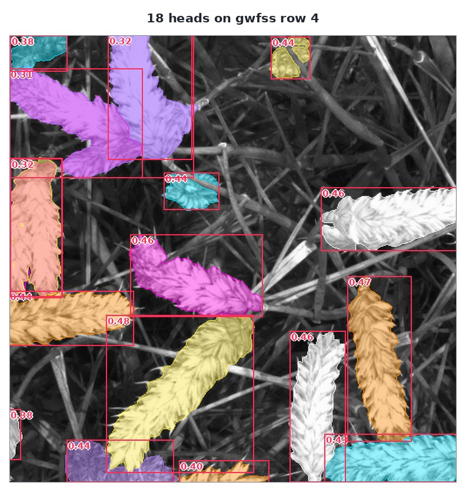

# Live demo

This page runs the model without you installing anything. The panel below is served by
`api.global-wheat.com` and framed here, so it is **same-origin with the API**: no cross-origin call is
involved anywhere, and your key is typed into the API's own page — this site never sees it. The
[reference](../api/reference.md) remembers the same key on the same origin: set it on either page and
the other uses it, Forget on either clears it for both.

## Run one

Paste your team's key, pick a row or a photograph, and press Run. The image is drawn as soon as the
address is complete — whole, at whatever size the page can show it in — with each box labelled by the
score the model gave it, and the mask decoded in your browser by the same decoder this site hands you.
The model line says how many machines are answering and how long ago the gateway last asked them, and
keeps that age climbing rather than letting a stale count pass for a live one.

The page also prints the call it would make as a `curl` command, with your key left as `$KEY`, so
anything you set up here can be taken straight to a shell.

<div id="play-frame">
  <iframe
    data-api-frame
    src="https://api.global-wheat.com/play"
    title="Global Wheat API — run one model"
    loading="lazy"
    style="display: block; width: 100%; height: 90vh; border: 0"
  ></iframe>
</div>

## A call we know works

Before the event we ran one call against the pool and kept its answer. Use it as your test case: if
your key and your client reproduce these numbers, both are working, and a difference is the thing to
debug rather than a reason to doubt the whole setup.

| | |
|---|---|
| address | `gwfss`, row `4` — 512×512, cut heads lying on straw |
| model | `sam3.1-meta`, `prompt="wheat head"`, `confidence_threshold=0.25` |
| came back | **18 objects** at `resolution_used` 1008; `Σ mask` = `Σ area` = **109,419 px** |

=== "Python"

    ```python
    answer = client.predict(
        "sam3.1-meta", "gwfss", 4, prompt="wheat head", confidence_threshold=0.25
    )
    ```

=== "JavaScript"

    ```js
    const answer = await client.predict("sam3.1-meta", "gwfss", 4, {
      prompt: "wheat head", confidence_threshold: 0.25,
    });
    ```

=== "Java"

    ```java
    Map<String, Object> answer = client.predict("sam3.1-meta", "gwfss", 4,
            Map.of("prompt", "wheat head", "confidence_threshold", 0.25));
    ```



Every mask's pixel count equals the `area` the answer reports, so the decode is checkable without
looking at the picture: sum the masks and compare with the `area` fields.

The object count and the boxes are what an answer is really about. The pixel counts are **one machine's**
— `computed_by` in this answer names `lab-3090` — and the same call on another card can differ by a
pixel, by a percent of a mask's area, or by one object at the margin.
[The model's page](../models/sam3.1-meta.md) is where the numbers behind that live.
