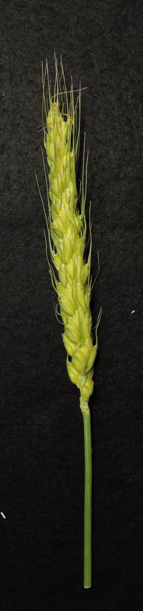
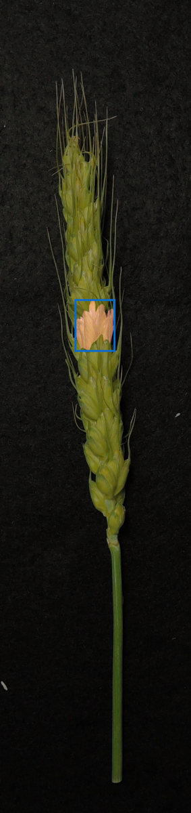

# Jupyter quickstart

<!-- notebook: skip -->
<div style="display:flex;justify-content:flex-end;gap:.5rem;flex-wrap:wrap" markdown>
[Download .ipynb](quickstart.ipynb){ .md-button }
[Open in Colab](https://colab.research.google.com/github/UTokyo-FieldPhenomics-Lab/gwhs-biohackathon-api-gateway/blob/main/docs/content/examples/quickstart.ipynb){ .md-button }
[Renku docs](https://docs.renkulab.io/en/stable/){ .md-button }
</div>
<!-- /notebook: skip -->

This page is the notebook: the cells below are what runs, and the `.ipynb` beside it is generated from
this markdown, so there is one version of the story. Ten steps, in the order you would actually do
them: get the client, get a key, look at what is there, take one row apart, run the model, and see what
a failure looks like.

Nothing but the client file needs installing — the model is behind the API, so Colab's stock Python
environment is enough, and [Renku's own documentation](https://docs.renkulab.io/en/stable/) covers
launching a session on it.

## 1. Get the client

One file, downloaded from this site rather than installed from a package index:

```bash
curl -sSO https://docs.global-wheat.com/clients/global_wheat.py
```

```python
import global_wheat

client = global_wheat.Client()
print(type(client).__name__)
```

<!-- output -->
``` { .text .output }
Client
```
<!-- /output -->

`Client()` reads the key from the environment, so nothing is pasted into a cell that gets saved or
shared.

## 2. Get a key

The organisers issue one key per team, and one key may have three *inferences* in flight — reading a
listing or a row is not counted. This asks for the key once, in memory:

```python
import getpass
import os

if "GLOBAL_WHEAT_API_KEY" not in os.environ:
    os.environ["GLOBAL_WHEAT_API_KEY"] = getpass.getpass("your team's key: ")
```

## 3. What is there

```python
for dataset in client.datasets():
    print(f"{dataset['id']:12s} {dataset['rows']:>4} rows  {dataset['geometry'] or 'palette'}")
```

<!-- output -->
``` { .text .output }
gwfss          10 rows  palette
gwhd           10 rows  boxes
gwhs-temp      10 rows  rle
```
<!-- /output -->

`describe` is the dataset's own contract — its filters, its classes, its palette — fetched once and
remembered by the client:

```python
description = client.describe("gwhs-temp")
print(sorted(description["filters"]))
print(sorted(description["filters"]["category"]))
```

<!-- output -->
``` { .text .output }
['attribute', 'category', 'split', 'tags']
['peduncle', 'spikelet _-_underdeveloped_side1', 'spikelet _-_underdeveloped_side2', 'spikelet_-_side1', 'spikelet_-_side2', 'spikelet_-_terminal']
```
<!-- /output -->

## 4. One row

An address is `(dataset, row)`. `gwhs-temp` is the development sample: same schema as `gwhs`, a handful
of rows, safe to call all day.

```python
row = client.image("gwhs-temp", 0)
print(row["width"], "x", row["height"], "—", len(row["objects"]), "objects")

first = row["objects"][0]
print(first["category"], first["bbox"], first["attributes"])
```

<!-- output -->
``` { .text .output }
592 x 2509 — 24 objects
spikelet_-_side1 [231.0, 923.0, 126.0, 162.0] ['Green-Spikelet']
```
<!-- /output -->

## 5. The picture

The annotation carries an address, not bytes, so the image itself is a second request to the CDN —
without a key, because `data.*` is public:

```python
from io import BytesIO

import numpy as np
from PIL import Image, ImageDraw

image = Image.open(BytesIO(client.image_bytes("gwhs-temp", 0))).convert("RGB")
thumbnail = image.copy()
thumbnail.thumbnail((400, 1200))
thumbnail
```

<!-- output -->

<!-- /output -->

## 6. One mask

Each object's `rle` was decoded as the answer arrived, and the raw string is still beside the mask.
The cheap proof that the decode is right: the pixel count equals the reported `area`.

```python
mask = first["mask"]
print(mask.shape, mask.dtype, int(mask.sum()), first["area"])
```

<!-- output -->
``` { .text .output }
(2509, 592) bool 12074 12074.0
```
<!-- /output -->

Drawing it is ordinary NumPy — the mask is already row-major and the size of the image:

```python
overlay = np.zeros((row["height"], row["width"], 3), dtype=np.uint8)
overlay[mask] = (255, 105, 180)

x, y, w, h = first["bbox"]
drawn = Image.blend(image, Image.fromarray(overlay), 0.35)
ImageDraw.Draw(drawn).rectangle([x, y, x + w, y + h], outline=(11, 107, 203), width=6)
drawn.thumbnail((400, 1200))
drawn
```

<!-- output -->

<!-- /output -->

## 7. A model

The same address, the same prompt shape: one published row, run on the pool's GPUs. What comes back is
the same geometry as ground truth, so the code that drew step 6 draws this too.

```python
answer = client.predict("sam3.1-meta", "gwhs-temp", 0, prompt="wheat head")
print(answer["model"], "at", answer["resolution_used"], "px")
print("answered by", answer["computed_by"]["machine"], answer["computed_by"]["gpu"])
print(len(answer["objects"]), "objects")

for found in answer["objects"]:
    print(found["idx"], round(found["score"], 3), int(found["area"]), found["bbox"])
```

<!-- output -->
``` { .text .output }
sam3.1-meta at 1008 px
answered by lab-5090 NVIDIA GeForce RTX 5090
1 objects
0 0.52 173716 [164.4509735107422, 227.70089721679688, 254.7406463623047, 1460.6804504394531]
```
<!-- /output -->

## 8. A palette mask

`gwfss` is the other kind of annotation: one mask image, one colour per organ. `label_masks` splits it
with the palette from `describe`, so no colour is ever copied from a figure.

```python
print([colour["name"] for colour in client.describe("gwfss")["classes"]])

palette_mask = np.asarray(Image.open(BytesIO(client.mask_bytes("gwfss", 0))))
for name, pixels in client.label_masks(palette_mask, "gwfss").items():
    print(f"{name:12s} {int(pixels.sum()):>7d} px")
```

<!-- output -->
``` { .text .output }
['background', 'head', 'stem', 'leaf']
background    146817 px
head               0 px
stem            1920 px
leaf          113407 px
```
<!-- /output -->

## 9. Your own photograph

An upload is the file itself, with the same parameters. `predict_file` decides the type from the
bytes, not from the name, and the API refuses anything it cannot decode — a phone's HEIC has to be
converted to JPEG first.

```python
import pathlib

photo = pathlib.Path("photo.jpg")
if photo.exists():
    mine = client.predict_file("sam3.1-meta", photo, prompt="wheat head")
    print(len(mine["objects"]), "objects in", photo)
else:
    print("put a photo beside this notebook, or upload one in Colab and name it here")
```

<!-- output -->
``` { .text .output }
put a photo beside this notebook, or upload one in Colab and name it here
```
<!-- /output -->

## 10. When it fails

A refusal is one body — `{"error": {"code": …, "message": …}}` — and the client raises it as one error
carrying the status, the code, and the API's own sentence:

```python
try:
    client.image("gwhd", 999999)
except global_wheat.ApiError as error:
    print(error.status, error.code)
    print(error.message)
```

<!-- output -->
``` { .text .output }
404 not_found
no such row
```
<!-- /output -->

Nothing is retried for you: `503` and `504` are worth another call, `400` never is.

## Next

- [Datasets](../datasets/index.md) — what each row holds, and what the fields mean
- [Clients](../api/clients.md) — the methods, and the same file in JavaScript and Java
- [Models](../models/sam3.1-meta.md) — the parameters, and what the model does and does not find
