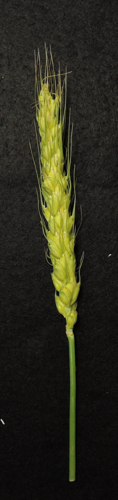
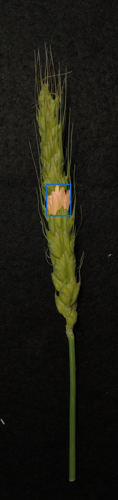
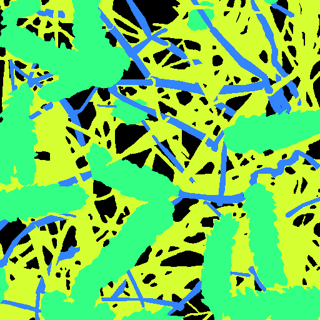
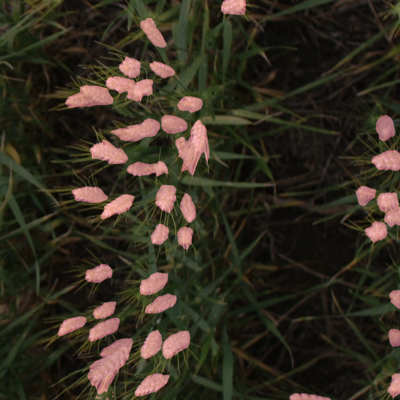
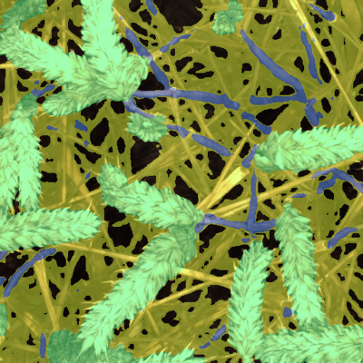
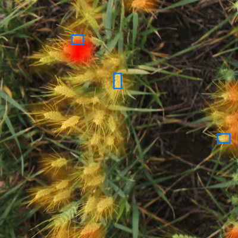
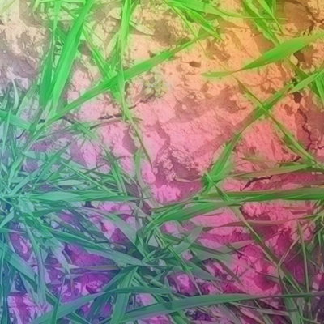

# Jupyter quickstart

<!-- notebook: skip -->
<div style="display:flex;justify-content:flex-end;gap:.5rem;flex-wrap:wrap" markdown>
[Download .ipynb](quickstart.ipynb){ .md-button }
[Open in Colab](https://colab.research.google.com/github/UTokyo-FieldPhenomics-Lab/gwhs-biohackathon-api-gateway/blob/main/docs/content/examples/quickstart.ipynb){ .md-button }
[Renku docs](https://docs.renkulab.io/en/stable/){ .md-button }
</div>
<!-- /notebook: skip -->

This page is the notebook: the cells below are what runs, and the `.ipynb` beside it is generated from
this markdown, so there is one version of the story. Three parts, in the order you would do them:
set up the client and the key, read and draw a dataset image, then run four models that answer in four
different shapes. The notebook runs top to bottom.

On Colab, NumPy, Pillow and requests are already installed, so the client is the only file to download.
Locally, run `pip install numpy pillow requests` once. [Renku's own
documentation](https://docs.renkulab.io/en/stable/) covers launching a session there.

## 1. Setup

### Get the client

One file, downloaded from this site rather than installed from a package index:

```bash
# A notebook runs a shell command after "!"; the .ipynb already has it.
curl -sSO https://docs.global-wheat.com/clients/global_wheat.py
```

```python
import numpy
import PIL
import requests

import global_wheat

print(
    "numpy", numpy.__version__,
    "| Pillow", PIL.__version__,
    "| requests", requests.__version__,
)
print(global_wheat.Client.__name__)
```

<!-- output -->
``` { .text .output }
numpy 2.5.4 | Pillow 13.0.0 | requests 2.34.2
Client
```
<!-- /output -->

Importing the client needs no key. Construct it after collecting your key in the next step.

### Get a key

The organisers issue one key per team, and one key may have three *inferences* in flight — reading a
listing or an image is not counted. This asks for the key once, in memory:

```python
import getpass
import os

if not os.environ.get("GLOBAL_WHEAT_API_KEY"):
    os.environ["GLOBAL_WHEAT_API_KEY"] = getpass.getpass("your team's key: ")

client = global_wheat.Client()
```

## 2. Datasets

An image is addressed as `(dataset, row)`. `row` is the image's position in the dataset's pinned
revision — the API's name for which image, not a stable id. `gwhd` and `gwfss` are published in full;
`gwhs` is not served until its annotation is released, and `gwhs-temp` is the ten-image sample with
the same schema.

### What is there

```python
for dataset in client.datasets():
    geometry = dataset["geometry"] or "palette"
    print(f"{dataset['id']:12s} {dataset['rows']:>4} images  {geometry}")
```

<!-- output -->
``` { .text .output }
gwfss        1096 images  palette
gwhd         6512 images  boxes
gwhs-temp      10 images  rle
```
<!-- /output -->

`describe` is the dataset's own contract. The filters it publishes are the keys you may narrow by,
and the values that actually occur — not a guess about how `Australia` is spelled:

```python
description = client.describe("gwhd")
print("filters:", sorted(description["filters"]))
print("splits:", sorted(description["filters"]["split"]))
```

<!-- output -->
``` { .text .output }
filters: ['category', 'country', 'development_stage', 'domain', 'location', 'split']
splits: ['test', 'train', 'validation']
```
<!-- /output -->

A list page carries one summary per image and never the annotation. Send a filter as a query
parameter, and follow `next_cursor` for the next page:

```python
page = client.images("gwhd", split="test", limit=3)
for summary in page["images"]:
    print(
        summary["row"], summary["split"],
        summary["width"], "x", summary["height"],
        "—", summary["statistics"]["objects"], "boxes",
    )
```

<!-- output -->
``` { .text .output }
0 test 1024 x 1024 — 144 boxes
1 test 1024 x 1024 — 12 boxes
2 test 1024 x 1024 — 85 boxes
```
<!-- /output -->

### One image

A detail response adds the annotation. `gwhs-temp` is the development sample: same schema as `gwhs`,
a handful of images, safe to call all day.

```python
ear = client.image("gwhs-temp", 0)
print(ear["width"], "x", ear["height"], "—", len(ear["objects"]), "objects")

first = ear["objects"][0]
print(first["category"], first["bbox"], first["attributes"])
```

<!-- output -->
``` { .text .output }
592 x 2509 — 24 objects
spikelet_-_side1 [231.0, 923.0, 126.0, 162.0] ['Green-Spikelet']
```
<!-- /output -->

### The picture

The annotation carries an address, not bytes, so the image itself is a second request to the CDN —
without a key, because `data.*` is public:

```python
from io import BytesIO

import numpy as np
from PIL import Image, ImageDraw

picture = Image.open(BytesIO(client.image_bytes("gwhs-temp", 0))).convert("RGB")
thumbnail = picture.copy()
thumbnail.thumbnail((400, 500))
thumbnail
```

<!-- output -->

<!-- /output -->

### One mask

Each object's `rle` was decoded as the answer arrived, and the raw string is still beside the mask.
The cheap proof that the decode is right: the pixel count equals the reported `area`.

```python
mask = first["mask"]
print(mask.shape, mask.dtype, int(mask.sum()), first["area"])
```

<!-- output -->
``` { .text .output }
(2509, 592) bool 12074 12074.0
```
<!-- /output -->

Drawing it is ordinary NumPy — the mask is already row-major and the size of the image:

```python
overlay = np.zeros((ear["height"], ear["width"], 3), dtype=np.uint8)
overlay[mask] = (255, 105, 180)

x, y, w, h = first["bbox"]
drawn = Image.blend(picture, Image.fromarray(overlay), 0.35)
ImageDraw.Draw(drawn).rectangle([x, y, x + w, y + h], outline=(11, 107, 203), width=6)
drawn.thumbnail((400, 500))
drawn
```

<!-- output -->

<!-- /output -->

### A palette mask

`gwfss` is the other kind of annotation: one mask image, one colour per organ. `label_masks` splits
it with the palette from `describe`, so no colour is ever copied from a figure.

```python
print([colour["name"] for colour in client.describe("gwfss")["classes"]])

palette_mask = Image.open(BytesIO(client.mask_bytes("gwfss", 4))).convert("RGB")
for name, pixels in client.label_masks(np.asarray(palette_mask), "gwfss").items():
    print(f"{name:12s} {int(pixels.sum()):>7d} px")

palette_mask.thumbnail((320, 320))
palette_mask
```

<!-- output -->
``` { .text .output }
['background', 'head', 'stem', 'leaf']
background     38922 px
head           86276 px
stem           27171 px
leaf          109775 px
```


<!-- /output -->

## 3. Models

A model call is the same address plus the model's own parameters. `predict` runs on a published
image, `predict_file` on your own bytes, and `generate` on a prompt alone. Every answer carries
`model`, `objects`, `resolution_used` and `computed_by`; what else is there depends on the task.

### A promptable segmenter

`sam3.1-meta` takes a phrase or an example and returns instances. On a `gwhd` plot the phrase
`seed head` finds the heads; `wheat head` answers nothing on this image, which is why the wording
matters more than the threshold.

```python
heads = client.predict(
    "sam3.1-meta", "gwhd", 4,
    prompt="seed head", confidence_threshold=0.31,
)
print(
    heads["model"], "at", heads["resolution_used"], "px —",
    len(heads["objects"]), "objects",
)
print("answered by", heads["computed_by"]["machine"], heads["computed_by"]["gpu"])
```

<!-- output -->
``` { .text .output }
sam3.1-meta at 1008 px — 44 objects
answered by lab-3090 NVIDIA GeForce RTX 3090
```
<!-- /output -->

The returned masks are the size of the image, so the code that drew the dataset mask draws this too:

```python
plot = Image.open(BytesIO(client.image_bytes("gwhd", 4))).convert("RGB")
found = np.zeros((plot.height, plot.width, 3), dtype=np.uint8)
for instance in heads["objects"]:
    found[instance["mask"]] = (255, 105, 180)

shown = Image.blend(plot, Image.fromarray(found), 0.45)
shown.thumbnail((400, 400))
shown
```

<!-- output -->

<!-- /output -->

### A semantic segmenter

`gwfss-segformer-b4` is semantic, not instance: one call returns one mask per foreground class
present, and nothing in the answer says how many heads the image holds.

```python
organs = client.predict("gwfss-segformer-b4", "gwfss", 4)
for organ in organs["objects"]:
    print(f"{organ['category']:6s} {int(organ['area']):>7d} px")
```

<!-- output -->
``` { .text .output }
head     88848 px
stem     15437 px
leaf    124434 px
```
<!-- /output -->

The dataset's palette is the model's palette, so the ground truth from the previous section and this
prediction can be compared directly:

```python
palette = {
    colour["name"]: tuple(int(colour["color"][i : i + 2], 16) for i in (1, 3, 5))
    for colour in client.describe("gwfss")["classes"]
}

field = Image.open(BytesIO(client.image_bytes("gwfss", 4))).convert("RGB")
organ_pixels = np.zeros((field.height, field.width, 3), dtype=np.uint8)
for organ in organs["objects"]:
    organ_pixels[organ["mask"]] = palette[organ["category"]]

prediction = Image.blend(field, Image.fromarray(organ_pixels), 0.45)
prediction.thumbnail((400, 400))
prediction
```

<!-- output -->

<!-- /output -->

### A counter

`tasselnetv4` is counting, not detection. Show it two or three example boxes and it answers a number,
with the local-count field that number is the sum of. `objects` stays empty: there is no box or mask
per head. The count is the model's estimate, not the annotation's: it is the sum of this field, and a
class-agnostic counter does not promise the dataset's box count. The three boxes below are the
[live demo](demo.md)'s `3 exemplars` example, so the same call can be reproduced there.

```python
exemplars = [
    [306, 148, 55, 44, 1],
    [487, 313, 37, 70, 1],
    [933, 573, 58, 43, 1],
]
counted = client.predict("tasselnetv4", "gwhd", 4, boxes=exemplars)
print(
    "count", round(counted["count"], 1),
    "— density", counted["density"]["size"],
)
print("objects:", len(counted["objects"]))
```

<!-- output -->
``` { .text .output }
count 41.4 — density [23, 23]
objects: 0
```
<!-- /output -->

The grid is coarse — one cell per counting window — so it is stretched over the photograph and drawn
with transparency: empty cells leave the photograph alone. Yellow is a low local count and red a high
one. The blue boxes are the three exemplars from the request, not detections: they show what the model
was asked to count.

```python
plot1 = Image.open(BytesIO(client.image_bytes("gwhd", 4))).convert("RGB")
density = np.asarray(counted["density"]["grid"], dtype=np.float32)
occupied = density[density > 0]
scale = np.percentile(occupied, 99) if occupied.size else 1.0
density = np.clip(density / scale, 0, 1)

heat = np.zeros((*density.shape, 4), dtype=np.uint8)
heat[..., 0] = 255
heat[..., 1] = (255 * (1 - density)).astype(np.uint8)
heat[..., 3] = (255 * density).astype(np.uint8)
heat_image = Image.fromarray(heat, "RGBA").resize(
    plot1.size, Image.Resampling.BILINEAR,
)

counted_image = Image.alpha_composite(
    plot1.convert("RGBA"), heat_image,
).convert("RGB")

drawing = ImageDraw.Draw(counted_image)
for x, y, w, h, _ in exemplars:
    drawing.rectangle([x, y, x + w, y + h], outline=(0, 120, 255), width=6)

counted_image.thumbnail((400, 400))
counted_image
```

<!-- output -->

<!-- /output -->

The red patch is the field's highest cell — about 44 pixels wide on this 1024-pixel image — around
the first exemplar, smoothed by the resize. It is a counting window, not one head's mask; the sum of
every cell is the count.

### A backbone

`dinov3-vitl16` has no class list, box or mask. It answers its own tokens: one vector for the whole
picture, and one vector per 16 × 16 patch. A head that turns those numbers into a mask or a class is
yours to fit.

```python
features = client.predict("dinov3-vitl16", "gwfss", 0, side=512)
print("embedding", np.asarray(features["embedding"]).shape)
print("features", features["features"]["grid"].shape, features["features"]["dtype"])
```

<!-- output -->
``` { .text .output }
embedding (1024,)
features (32, 32, 1024) float16
```
<!-- /output -->

The example is `gwfss` image 0 at `side=512`, the image the play page uses when this backbone is
selected. The first three principal components of the patch grid, mapped to red, green and blue, are
the standard way to see what an encoder without a head has learned. The play page's `results` eye
draws the first three components over the photograph at 55%; its `image` eye turns the photograph off
to read the colours on their own. Each picture supplies its own basis, so the colours are not
comparable between two images.

```python
grid = features["features"]["grid"].astype(np.float32)
patches = grid.reshape(-1, grid.shape[-1])
centred = patches - patches.mean(axis=0)
_, _, components = np.linalg.svd(centred, full_matrices=False)
for row in range(3):
    if components[row].sum() < 0:
        components[row] *= -1
pca = centred @ components[:3].T

def stretch(channel):
    low, high = np.percentile(channel, [2, 98])
    return np.clip((channel - low) / max(high - low, 1e-6), 0, 1)

rgb = np.stack([stretch(pca[:, i]) for i in range(3)], axis=-1)
rgb = rgb.reshape(*grid.shape[:2], 3)

source = Image.open(BytesIO(client.image_bytes("gwfss", 0))).convert("RGB")
pca_layer = Image.fromarray((rgb * 255).astype(np.uint8)).resize(
    source.size, Image.Resampling.BILINEAR,
)
pca_image = Image.blend(source, pca_layer, 0.55)
pca_image.thumbnail((400, 400))
pca_image
```

<!-- output -->

<!-- /output -->

### Your own photograph

An upload is the file itself, with the same parameters. `predict_file` decides the type from the
bytes, not from the name, and the API refuses anything it cannot decode — a phone's HEIC has to be
converted to JPEG first. The model resizes whatever it receives to the side it runs at, so a larger
photograph buys nothing.

```python
import pathlib
from io import BytesIO

from PIL import Image, ImageOps

photo = pathlib.Path("photo.jpg")
if photo.exists():
    with Image.open(photo) as shot:
        shot = ImageOps.exif_transpose(shot)
        shot.thumbnail((1008, 1008))
        prepared = BytesIO()
        shot.convert("RGB").save(prepared, "JPEG", quality=90)

    mine = client.predict_file("sam3.1-meta", prepared.getvalue(), prompt="seed head")
    print(len(mine["objects"]), "objects in", photo, "at", mine["resolution_used"], "px")
else:
    print("put a photo beside this notebook, or upload one in Colab and name it here")
```

<!-- output -->
``` { .text .output }
put a photo beside this notebook, or upload one in Colab and name it here
```
<!-- /output -->

### The rest of the catalogue

These calls are not executed here: one of them spends image credits, and the point is a line to
copy rather than an output to record. Each model page has the full parameter table and an example
answer.

| model | one call | you get back |
|---|---|---|
| [`wevisone-vl-4b`](../models/wevisone-vl-4b.md) | `client.predict("wevisone-vl-4b", "gwhs-temp", 0, prompt="wheat head")` | instances, each with a mask; no score |
| [`internvl-u`](../models/internvl-u.md) | `client.predict("internvl-u", "gwhs-temp", 0, prompt="Describe this image.", mode="text")` | prose in `answer` |
| [`sprout-l-gwfss`](../models/sprout-l-gwfss.md) | `client.predict("sprout-l-gwfss", "gwfss", 4)` | one mask per organ |
| [`dinov3-vith16plus`](../models/dinov3.md) | `client.predict("dinov3-vith16plus", "gwfss", 0, side=384)` | `embedding` and `features` |
| [`yolo26-ultralytics`](../models/yolo.md) | `client.predict_file("yolo26-ultralytics", "photo.jpg")` | COCO boxes; empty on a wheat image |
| [`yolo26-seg-ultralytics`](../models/yolo.md) | `client.predict_file("yolo26-seg-ultralytics", "photo.jpg")` | COCO boxes and masks; empty on a wheat image |
| [Nano Banana](../models/nano-banana.md) — `nano-banana-2.1` · `nano-banana-2` · `nano-banana-pro` | `client.generate("nano-banana-2.1", prompt="a wheat field at golden hour", aspect_ratio="16:9", image_size="1K")` | a picture in `image`; the same call with either other id |

`gwhs-temp` is the development sample; `gwhs` is not served until its annotation is released. The two
YOLO ids were trained on COCO, so a `gwhd` image answers `[]` and your own photograph is the input
they want. The Nano Banana call spends image credits, which is why this table is not run here.
`client.model(id)["parameters"]` lists every parameter with its bounds; the same method names reach
the JavaScript and Java clients, with their own parameter syntax in [Clients](../api/clients/index.md).

### When a call fails

A refusal is one body — `{"error": {"code": …, "message": …}}` — and the client raises it as one error
carrying the status, the code, and the API's own sentence:

```python
try:
    client.image("gwhd", 999999)
except global_wheat.ApiError as error:
    print(error.status, error.code)
    print(error.message)
```

<!-- output -->
``` { .text .output }
404 not_found
no such row
```
<!-- /output -->

The client does not retry a failed call automatically: `502`, `503` and `504` are worth another
call; `400` requires correcting the request. The gateway may already have tried another backend.

## Next

- [Datasets](../datasets/index.md) — what each image holds, and what the fields mean
- [Clients](../api/clients/index.md) — the methods, and the same file in JavaScript and Java
- [Models](../models/sam3.1-meta.md) — the parameters, and what the model does and does not find
- [Agent skills](agent-skills.md) — hand the API to your agent with one sentence
