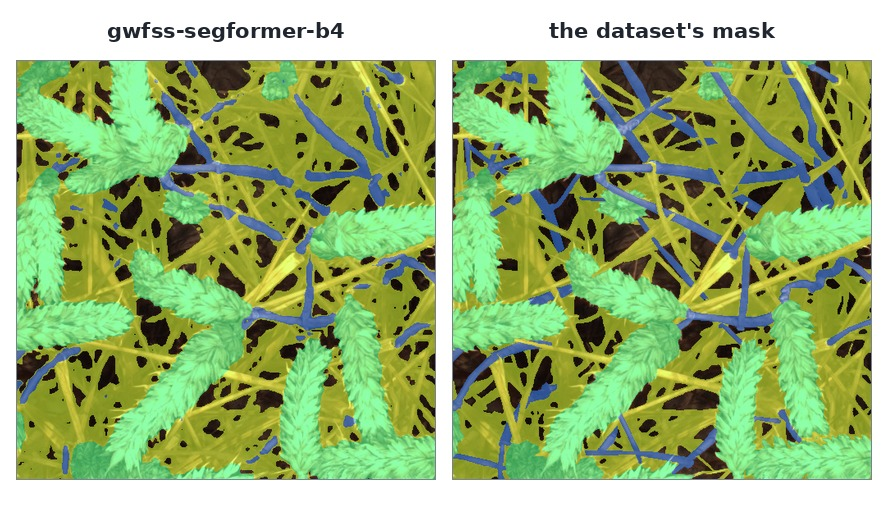

# `gwfss-segformer-b4`

The segmentation baseline published with the dataset this API serves: a SegFormer-B4 fine-tuned on
[GWFSS, the Global Wheat Full Semantic Organ Segmentation dataset](https://doi.org/10.1016/j.plaphe.2025.100084).
Send it a `gwfss` row, or your own photograph, and it answers with the four organ classes in the
dataset's own palette — `background`, `head`, `stem`, `leaf`.



It is a **semantic** model, not an instance one. One call returns three masks, one per organ present;
nothing in the answer says how many heads the image holds. Counting them is a connected-component
pass over the `head` mask, and [the example below](#counting-heads) is that pass.

Ten of the dataset's 1,096 annotated rows are published today; the rest land before the event. Row 4,
shown above and used throughout this page, is the demo image: cut heads lying on straw.

## Parameters

<!-- parameters:start -->
This model declares **no parameters**: an image is the whole request, and a query string is refused rather than ignored.
<!-- parameters:end -->

That is the whole surface: an image in, a class map out. `?prompt=…` on this model is a `400` rather
than a parameter that is silently ignored — the gateway checks every name against what the model
declared, and this model declared an empty list.

## What comes back

One object per class that has pixels. Background is the complement and is not returned.

```json
{"model": "gwfss-segformer-b4", "resolution_used": 512,
 "objects": [
   {"idx": 0, "category": "head", "bbox": [0, 0, 512, 512], "score": 0.949, "area": 88848.0,
    "rle": {"size": [512, 512], "counts": "…"}},
   {"idx": 1, "category": "stem", "bbox": [0, 0, 512, 505], "score": 0.694, "area": 15437.0,
    "rle": {"size": [512, 512], "counts": "…"}},
   {"idx": 2, "category": "leaf", "bbox": [0, 0, 512, 512], "score": 0.783, "area": 124434.0,
    "rle": {"size": [512, 512], "counts": "…"}}]}
```

Row 4's answer is those areas and no more: 88,848 px of head, 15,437 of stem, 124,434 of leaf, and
33,425 px of background, which is what the three masks leave over.

Two fields mean something other than what they mean on `sam3.1-meta`:

- **`bbox` is the class's extent, not an object's box.** A head strip across the frame and a head
  lying in one corner both describe themselves correctly; neither says "this is one head".
- **`score` is the mean probability of that class over the pixels it owns.** It is derived,
  uncalibrated, and not comparable between classes — read it as "how sure was the network about the
  pixels it did assign", not as a detector's confidence.

## What it is good at

Measured through this container on the ten published `gwfss` rows, on a laboratory 3090:

| class | IoU |
|---|---|
| head | 0.866 |
| leaf | 0.825 |
| background | 0.747 |
| stem | 0.366 |
| **mIoU** | **0.701** |

Pixel accuracy is 0.884 and a 512 px call takes 38 ms. Heads and leaves are what it does well. Stems
are the weak class — thin, often occluded, and a small share of the pixels — and the dataset's own
paper reports the same weakness. The other large error is leaf against background: on this row, straw
takes leaf pixels and leaf takes straw pixels.

Do not read 0.70 as a generalisation result. The released checkpoint does not document which rows it
was trained on, so a score on a published row may be a score on its own training data. The paper's
own figures — about 90 % for leaves and heads, 45–54 % for stems — are computed on its splits, and
this page does not restate them as this container's.

## Size

`512` is the side the checkpoint was trained and saved at, and the processor fixes it; there is no
`imgsz` to set and no other side was measured. Your image is resized to 512 before the network sees
it, and the masks come back at your image's size — so a 12 MP photograph answers in about 0.2 s, with
the boundaries a 512 px network can resolve stretched over it. `resolution_used` says 512 either way.

## Counting heads

`head` is a class, not a list of heads. If you want a count, label the components:

```python
import numpy as np
from scipy import ndimage

answer = client.predict("gwfss-segformer-b4", "gwfss", 4)   # object["mask"] arrives decoded
head = next(o for o in answer["objects"] if o["category"] == "head")["mask"]
labels, count = ndimage.label(head, structure=np.ones((3, 3)))
sizes = np.bincount(labels.ravel())[1:]
print(count, "components,", int((sizes > 50).sum()), "over 50 px")
```

Expect that count to over-split a dense canopy: a semantic model draws boundaries where the organs
overlap, and overlapping leaves are one region in its output. It is a useful number, not the ears per
square metre a breeding trial wants — that is what `gwhd` and a detector are for.

## Where it comes from

Wang et al., *The Global Wheat Full Semantic Organ Segmentation (GWFSS) dataset*, Plant Phenomics
2025, [10.1016/j.plaphe.2025.100084](https://doi.org/10.1016/j.plaphe.2025.100084). Weights:
[`GlobalWheat/GWFSS_Segformer_b4`](https://huggingface.co/GlobalWheat/GWFSS_Segformer_b4),
CC-BY-4.0, pinned by commit in the container and fetched at build.

The paper's Table 4 model is the smaller **B1** — 13.7 M parameters, [published
too](https://huggingface.co/GlobalWheat/GWFSS_Segformer_b1) — and it is not served here. With the API
in front of it, the smaller backbone buys a caller nothing: this one answers in 38 ms and is better on
every class.
