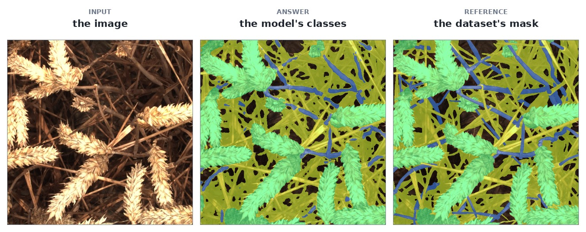

# `gwfss-segformer-b4`

The segmentation baseline published with the dataset this API serves: a SegFormer-B4 fine-tuned on
[GWFSS, the Global Wheat Full Semantic Organ Segmentation dataset](https://doi.org/10.1016/j.plaphe.2025.100084).
Send it a `gwfss` image, or your own photograph, and it answers with the three foreground organ classes
in the dataset's own palette — `head`, `stem` and `leaf`. Background is the complement and is not
returned. It is a **semantic** model, not an instance one: one call returns one mask per class present,
and nothing in the answer says how many heads the image holds.

## At a glance

| field | value |
|---|---|
| Task | semantic organ segmentation |
| Input | a dataset image or upload |
| Output | one object per foreground class, with a COCO RLE `mask` |
| Runs at | 512 px square |
| Typical wait | about 0.2 s |
| License | [CC-BY-4.0](#references) |



All 1,096 annotated images are published. Image 4 (`row` 4), shown above and used throughout this page, is the demo
image: cut heads lying on straw.

**[Try it on the live demo](https://api.global-wheat.com/play?model=gwfss-segformer-b4)** — the model is
already selected; pick `gwfss` image 4 (`row` 4) and press Run.

## When to use it

**Good at**

- Labelling every pixel of a wheat canopy as head, stem or leaf, in the dataset's own palette.
- A fast answer on a square field photograph: 512 px in, masks at your image's size out.
- A baseline you can compare your own segmentation against.

**Not for**

- **Instances.** `head` is a class, not a list of heads. Counting is a connected-component pass over the
  mask, not a count of objects in the answer.
- **A guaranteed score.** The released checkpoint does not document which images it was trained on, so a
  score on a published image may be a score on its own training data.
- **Stems in particular.** They are thin, often occluded and a small share of the pixels; the stem IoU
  is far below head and leaf.

**Limits**

- The side is fixed at 512 and there is no parameter to change it; a non-square image is stretched.
- Background is the complement and is not returned as an object.
- The model declares no parameters: any query parameter is a `400` rather than being ignored.

## Call it

With the client from [Clients](../api/clients/index.md) set up, or the `API` and `KEY` variables from [Raw HTTP](../api/http/index.md#five-calls):

=== "Python"

    ```python
    answer = client.predict("gwfss-segformer-b4", "gwfss", 4)
    ```

=== "JavaScript"

    ```js
    const answer = await client.predict("gwfss-segformer-b4", "gwfss", 4);
    ```

=== "Java"

    ```java
    Map<String, Object> answer = client.predict("gwfss-segformer-b4", "gwfss", 4);
    ```

=== "HTTP"

    ```bash
    curl -s -H "X-API-Key: $KEY" -H "Content-Type: application/json" \
      -d '{"dataset": "gwfss", "row": 4}' \
      "$API/models/gwfss-segformer-b4/predict"
    ```

## Parameters

<!-- parameters:start -->
This model declares **no parameters**: an image is the whole request, and a query string is refused rather than ignored.
<!-- parameters:end -->

That is the whole surface: an image in, a class map out. `?prompt=…` on this model is a `400` rather
than a parameter that is silently ignored — the gateway checks every name against what the model
declared, and this model declared an empty list.

## What comes back

One object per class that has pixels. Background is the complement and is not returned.

```json
{"model": "gwfss-segformer-b4", "resolution_used": 512,
 "objects": [
   {"idx": 0, "category": "head", "bbox": [0, 0, 512, 512], "score": 0.949, "area": 88848.0,
    "rle": {"size": [512, 512], "counts": "…"}},
   {"idx": 1, "category": "stem", "bbox": [0, 0, 512, 505], "score": 0.694, "area": 15437.0,
    "rle": {"size": [512, 512], "counts": "…"}},
   {"idx": 2, "category": "leaf", "bbox": [0, 0, 512, 512], "score": 0.783, "area": 124434.0,
    "rle": {"size": [512, 512], "counts": "…"}}]}
```

Row 4's answer is those areas and no more: 88,848 px of head, 15,437 of stem, 124,434 of leaf, and
33,425 px of background, which is what the three masks leave over.

Two fields mean something other than what they mean on `sam3.1-meta`:

- **`bbox` is the class's extent, not an object's box.** A head strip across the frame and a head
  lying in one corner both describe themselves correctly; neither says "this is one head".
- **`score` is the mean probability of that class over the pixels it owns.** It is derived,
  uncalibrated, and not comparable between classes — read it as "how sure was the network about the
  pixels it did assign", not as a detector's confidence.


## What you can do with it

### Counting heads

`head` is a class, not a list of heads. If you want a count, label the components:

```python
import numpy as np
from scipy import ndimage

answer = client.predict("gwfss-segformer-b4", "gwfss", 4)   # object["mask"] arrives decoded
head = next(o for o in answer["objects"] if o["category"] == "head")["mask"]
labels, count = ndimage.label(head, structure=np.ones((3, 3)))
sizes = np.bincount(labels.ravel())[1:]
print(count, "components,", int((sizes > 50).sum()), "over 50 px")
```

Expect that count to over-split a dense canopy: a semantic model draws boundaries where the organs
overlap, and overlapping leaves are one region in its output. It is a useful number, not the ears per
square metre a breeding trial wants — that is what `gwhd` and a detector are for.

## Performance

### Quality

Measured through this container on the ten published `gwfss` images, on a laboratory 3090:

| class | IoU |
|---|---|
| head | 0.866 |
| leaf | 0.825 |
| background | 0.747 |
| stem | 0.366 |
| **mIoU** | **0.701** |

Pixel accuracy is 0.884. Heads and leaves are what it does well. Stems are the weak class — thin,
often occluded, and a small share of the pixels — and the dataset's own paper reports the same
weakness. The other large error is leaf against background: on this image, straw takes leaf pixels and
leaf takes straw pixels.

Do not read 0.70 as a generalisation result. The released checkpoint does not document which images it
was trained on, so a score on a published image may be a score on its own training data. The paper's own
figures — about 90 % for leaves and heads, 45–54 % for stems — are computed on its splits, and this page
does not restate them as this container's.

### Speed

`512` is the side the checkpoint was trained and saved at, and the processor fixes it; there is no
`imgsz` to set and no other side was measured. Your image is resized to 512 before the network sees
it, and the masks come back at your image's size — so a 12 MP photograph answers in about 0.2 s, with
the boundaries a 512 px network can resolve stretched over it. `resolution_used` says 512 either way.

## References

- **Paper (method)** — Xie et al., “SegFormer: Simple and Efficient Design for Semantic Segmentation
  with Transformers,” NeurIPS 2021. [arXiv:2105.15203](https://arxiv.org/abs/2105.15203)
- **Paper (fine-tune data)** — Wang et al., “The Global Wheat Full Semantic Organ Segmentation
  (GWFSS) dataset,” Plant Phenomics 2025.
  [doi:10.1016/j.plaphe.2025.100084](https://doi.org/10.1016/j.plaphe.2025.100084)
- **Weights** — [GlobalWheat/GWFSS_Segformer_b4](https://huggingface.co/GlobalWheat/GWFSS_Segformer_b4)
- **License** — [CC-BY-4.0](https://creativecommons.org/licenses/by/4.0/)
