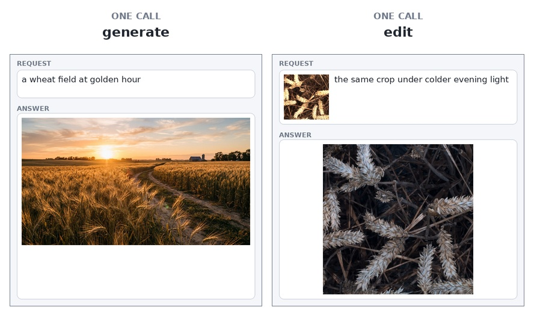

# Nano Banana

<!-- models: nano-banana-2 nano-banana-2.1 nano-banana-pro -->

Three image models from Google, served through **Vertex AI**: a picture from a prompt, or a new
version of a picture you already have. The weights are Google's and run on Google's hardware; nothing
is downloaded to you.

## At a glance

| field | value |
|---|---|
| Task | text-to-image, and image editing at the level of the frame |
| Input | `prompt` alone (`generate`), or an image and `prompt` (`predict`) |
| Output | a picture in `image`; prose in `answer` where the model wrote any |
| Runs at | 1K or 2K on the longer side, depending on the id |
| Typical wait | 15–19 s per picture |
| License | [Google Cloud terms](#references) |



Two recorded calls on `nano-banana-2.1` at 1K: `generate` makes a wheat field at golden hour;
`edit` changes `gwfss` image 4 (`row` 4) under colder evening light. Each panel is one call, not a
chat session.

### The three ids

| property | `nano-banana-2.1` | `nano-banana-2` | `nano-banana-pro` |
|---|---|---|---|
| offers | 1K, 2K | 512, 1K, 2K | 1K |
| one 1K picture, list price | $0.0336 | $0.0672 | $0.134 |
| team allowance, 1K pictures | 200 | 100 | 50 |

The three ids are one product line at three tiers. **`nano-banana-2.1`** is the cheaper default and the
one to reach for; **`nano-banana-2`** is the earlier checkpoint, served for comparison; and
**`nano-banana-pro`** is the largest and most expensive. The prices are the upstream list prices at 1K;
the allowance is counted in credits, where one 1K 2.1 picture is one, a 2K picture costs 1.5, one on
`nano-banana-2` costs 2, and one on `nano-banana-pro` costs 4.

**[Try the 2.1](https://api.global-wheat.com/play?model=nano-banana-2.1)** — it is selected already,
and the image's photograph is what the prompt changes. The `results` eye shows the picture the model
produced.

## When to use it

**Good at**

- Making a picture from a prompt with no input image.
- Editing a picture you already have — a published image or your own photograph — at the level of the
  whole frame: light, season, style, a different scene.
- Returning a frame that lines up with the picture you sent, so the answer can be laid over it.

**Not for**

- **Measurements.** A count, a mask or a diagnosis it gives you is a description of an image it drew.
  Use [`tasselnetv4`](tasselnetv4.md), [`sam3.1-meta`](sam3.1-meta.md) or
  [`gwfss-segformer-b4`](gwfss-segformer-b4.md) for numbers and geometry.
- **One-detail edits.** One awn, one lesion or one label is beyond what one prompt and one generation
  will reliably give you.
- **Treating an aligned answer as a measurement.** `frame` makes the answer the same shape as yours and
  puts your picture's box where it belongs; the pixels inside that box are the model's, not yours.

**Limits**

- `prompt` is required and at most 300 characters; the query is capped at 2 KB, so a longer prompt is a
  `400` rather than a truncated instruction.
- `4K` is not offered: its base64 body can exceed the gateway's 16 MiB answer ceiling.
- At most **two** pictures are generated at once across all teams; a third is refused rather than
  queued. A picture also takes one of your three inferences.

**Cost**

One call is one picture, charged against **your team's allowance** and against a shared pot with a
daily ceiling. When either is exhausted the API answers `429` with the reason in the message. Waiting
until Japan midnight resets the daily figure, not the event allowance.

## Call it

With the client from [Clients](../api/clients/index.md) set up, or the `API` and `KEY` variables from [Raw HTTP](../api/http/index.md#five-calls):

### Generate

=== "Python"

    ```python
    answer = client.generate(
        "nano-banana-2.1",
        prompt="a wheat field at golden hour",
        aspect_ratio="16:9",
        image_size="1K",
    )
    answer["image"]["picture"].save("field.png")
    ```

=== "JavaScript"

    ```js
    const answer = await client.generate("nano-banana-2.1", {
      prompt: "a wheat field at golden hour",
      aspect_ratio: "16:9",
      image_size: "1K",
    });
    ```

=== "Java"

    ```java
    Map<String, Object> answer = client.generate("nano-banana-2.1",
        Map.of("prompt", "a wheat field at golden hour",
               "aspect_ratio", "16:9", "image_size", "1K"));
    ```

=== "HTTP"

    ```bash
    curl -s -X POST -H "X-API-Key: $KEY" \
      "$API/models/nano-banana-2.1/generate?prompt=a%20wheat%20field%20at%20golden%20hour&aspect_ratio=16:9&image_size=1K" \
      -o answer.json
    ```

### Edit

=== "Python"

    ```python
    answer = client.predict_file(
        "nano-banana-2.1", "my-photo.jpg",
        prompt="the same crop under colder evening light",
    )
    answer["image"]["picture"].save("evening.png")
    ```

=== "JavaScript"

    ```js
    const answer = await client.predict_file("nano-banana-2.1", file, {
      prompt: "the same crop under colder evening light",
    });
    ```

=== "Java"

    ```java
    Map<String, Object> answer = client.predict_file("nano-banana-2.1",
        new java.io.File("my-photo.jpg"),
        Map.of("prompt", "the same crop under colder evening light"), true);
    ```

=== "HTTP"

    ```bash
    curl -s -X POST -H "X-API-Key: $KEY" -H "Content-Type: application/json" \
      -d '{"dataset": "gwfss", "row": 3}' \
      "$API/models/nano-banana-2.1/predict?prompt=the%20same%20crop%20under%20colder%20evening%20light&image_size=1K" \
      -o answer.json
    ```

`generate` has no image of your own and is never cached: the same prompt twice is two pictures and two
charges. `predict_file` sends your photograph, and `predict` does the same on a published image.

## Parameters

All three answer the same three parameters, and they ride in the **query string**: the request is one
URL, with no body.

### `nano-banana-2.1`

<!-- parameters:nano-banana-2.1:start -->
| parameter | default | accepts | what it does |
|---|---|---|---|
| `prompt` | — | text, at most 300 characters | What to draw, or how to change the picture you sent. Required: this model has no default prompt. |
| `aspect_ratio` | `auto` | `auto`, `1:1`, `2:3`, `3:2`, `3:4`, `4:3`, `4:5`, `5:4`, `9:16`, `16:9`, `21:9` | The shape of the answer. `auto` keeps the frame of the picture you sent on an edit — the canvas is extended to the nearest supported ratio and the answer maps back to it — and is 1:1 for a generate. Any other value asks for a new frame: the answer is then a reframe and does not align with the picture you sent. |
| `image_size` | `1K` | `1K`, `2K` | The longer side of the picture. The list is what this deployment offers, not the upstream model's full range: 4K is left out because its answer can exceed the gateway's payload ceiling. |
<!-- parameters:nano-banana-2.1:end -->

### `nano-banana-2`

<!-- parameters:nano-banana-2:start -->
| parameter | default | accepts | what it does |
|---|---|---|---|
| `prompt` | — | text, at most 300 characters | What to draw, or how to change the picture you sent. Required: this model has no default prompt. |
| `aspect_ratio` | `auto` | `auto`, `1:1`, `2:3`, `3:2`, `3:4`, `4:3`, `4:5`, `5:4`, `9:16`, `16:9`, `21:9` | The shape of the answer. `auto` keeps the frame of the picture you sent on an edit — the canvas is extended to the nearest supported ratio and the answer maps back to it — and is 1:1 for a generate. Any other value asks for a new frame: the answer is then a reframe and does not align with the picture you sent. |
| `image_size` | `1K` | `512`, `1K`, `2K` | The longer side of the picture. The list is what this deployment offers, not the upstream model's full range: 4K is left out because its answer can exceed the gateway's payload ceiling. |
<!-- parameters:nano-banana-2:end -->

### `nano-banana-pro`

<!-- parameters:nano-banana-pro:start -->
| parameter | default | accepts | what it does |
|---|---|---|---|
| `prompt` | — | text, at most 300 characters | What to draw, or how to change the picture you sent. Required: this model has no default prompt. |
| `aspect_ratio` | `auto` | `auto`, `1:1`, `2:3`, `3:2`, `3:4`, `4:3`, `4:5`, `5:4`, `9:16`, `16:9`, `21:9` | The shape of the answer. `auto` keeps the frame of the picture you sent on an edit — the canvas is extended to the nearest supported ratio and the answer maps back to it — and is 1:1 for a generate. Any other value asks for a new frame: the answer is then a reframe and does not align with the picture you sent. |
| `image_size` | `1K` | `1K` | The longer side of the picture. The list is what this deployment offers, not the upstream model's full range: 4K is left out because its answer can exceed the gateway's payload ceiling. |
<!-- parameters:nano-banana-pro:end -->

`prompt` is **required** in every call. `4K` is not offered: its base64 body can exceed the gateway's
16 MiB answer ceiling. `aspect_ratio` defaults to **`auto`**: on an edit that keeps the frame of the
picture you sent; on a `generate` there is no picture, so it is `1:1`. Naming a ratio is how you ask for
a different frame.

## What comes back

```json
{
  "model": "nano-banana-2.1",
  "objects": [],
  "answer": "Here is a photorealistic shot of a single wheat spike against dark soil.",
  "image": {
    "media_type": "image/png",
    "width": 1376,
    "height": 768,
    "data": "iVBORw0KGgoAAAANSUhEUg…"
  },
  "resolution_used": 1376,
  "computed_by": {"machine": "vertex-global"}
}
```

`objects` is present and empty, so the same client parses this answer and a segmenter's. The prose,
where the model wrote any, is in `answer`; the picture is in `image`. `image.data` is base64 of the
encoded file, exactly as the model produced it — the picture is not stored and served from a URL, it is
the answer.

The clients decode it for you: `image["picture"]` is a Pillow image in Python, the file's bytes in
JavaScript and Java. Nothing on this service re-encodes it — and on an edit at `auto`, the client has
already cropped it back to your picture's frame.

### The frame

An **edit** at `aspect_ratio=auto` also carries `frame`, because the model only generates at the ratios
in the table and your picture may not be one of them:

```json
"image": {"media_type": "image/png", "width": 1376, "height": 688, "data": "iVBORw0KGgo…"},
"frame": {"width": 1024, "height": 512, "content": [0.0, 0.0727, 1.0, 0.9273]}
```

`frame.width` × `frame.height` is the picture you sent; `frame.content` is where that picture sits in
`image.data`, as fractions — here the answer carries a band above and below it. The whole frame is
`[0, 0, 1, 1]`, and then no crop is needed. The clients crop it for you; over plain HTTP it is four
numbers and one crop:

```python
import base64, io, json
from PIL import Image

body = json.load(open("answer.json"))
raw = Image.open(io.BytesIO(base64.b64decode(body["image"]["data"])))
x0, y0, x1, y1 = body["frame"]["content"]
raw.crop((round(x0 * raw.width), round(y0 * raw.height),
          round(x1 * raw.width), round(y1 * raw.height))).save("edit.png")
```

Naming a ratio is a deliberate **reframe** — `aspect_ratio=16:9` on a 2:1 photograph. That answer keeps
the ratio you named, carries no `frame`, and its `warnings[0].code` is `reframed`. To keep your
picture's frame, leave the parameter at `auto` or crop the picture yourself before sending.

The crop is a frame, not a measurement: the model redraws the whole picture, so the answer lines up
with yours while its pixels are new.

## Performance

From the host in Frankfurt, through the public API, one picture per call:

| call | latency | what it produced |
|---|---|---|
| `generate`, 1K, 1:1 | **15.2 s** | 1.5 MB PNG, 1024 × 1024 |
| `generate`, 1K, 16:9 | **18.7 s** | 1.9 MB PNG, 1376 × 768 |
| `predict`, 1K, `gwhd` image 0 | **17.2 s** | 1.6 MB PNG, 1024 × 1024 |

The answer carries the model's reasoning as `thought` parts, including a draft picture the same size as
the final one; this service drops both, so the body is one picture rather than two. 2K and
`nano-banana-pro` are measured before the event, not extrapolated.

## References

- **Provider** — Google Vertex AI — [Google Cloud terms](https://cloud.google.com/terms)
- **Prohibited use** — [Generative AI Prohibited Use Policy](https://policies.google.com/terms/generative-ai)
- **Weights** — not distributed by this service.
- **License** — [Google Cloud Platform terms](https://cloud.google.com/terms)
