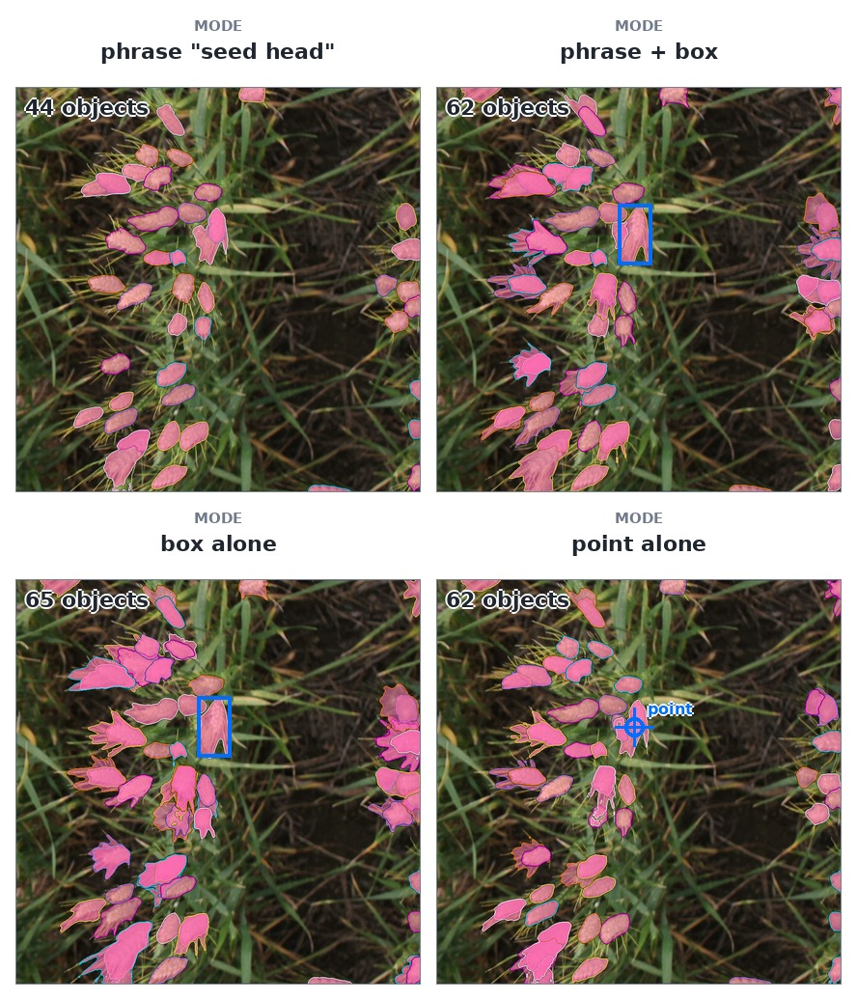

# `sam3.1-meta`

SAM 3.1 — text- and geometry-prompted instance segmentation, from [Meta's own code and
checkpoint](https://github.com/facebookresearch/sam3). Send an image address — or your own photograph —
with a phrase, a box or a point, and it answers with boxes, scores and masks. The id says whose weights
these are: `meta` is the upstream release, not a wheat fine-tune.

## At a glance

| field | value |
|---|---|
| Task | instance segmentation from a phrase, box or point |
| Input | a dataset image or upload, plus `prompt`, `boxes` or `points` |
| Output | objects with `bbox`, `score` and a COCO RLE `mask` |
| Runs at | 672 / 784 / 896 / 1008 px square; default 1008 |
| Typical wait | 0.13–0.21 s |
| License | [SAM License](#references) |



Four recorded prompt forms on `gwhd` image 4 (`row` 4) at `confidence_threshold=0.31`: the phrase
alone, the phrase with one exemplar box, the box alone, and a point alone. Masks are drawn; every
object also carries a box and a score.

**[Try it on the live demo](https://api.global-wheat.com/play?model=sam3.1-meta)** — four recorded
prompt forms are shown above, so you can check yours against them.

## When to use it

**Good at**

- Finding every instance of a short noun phrase — `wheat head`, `spikelet`, `leaf` — with a mask each.
- A phrase plus a box or a point, when the words alone are ambiguous.
- Returning nothing when the concept is not in the picture, rather than a low-confidence guess.

**Not for**

- **A wheat fine-tune.** It is Meta's checkpoint; whether it finds a head depends on the words or the
  example you give it.
- **Counting.** An answer is a set of masks with scores; a count is how many survive your threshold.
- **Per-object classification.** A mask's `category` is the phrase you asked for, or `null` when you
  gave geometry alone.
- **An empty answer is not a threshold problem.** It means the model does not see that concept here;
  change the words or add an example instead.

**Limits**

- `prompt` is at most 200 characters.
- `imgsz` accepts only the four measured sides; a larger value runs at 1008 with a warning.
- An upload follows the shared [50 MP limit](../api/http/index.md#limits).

## Call it

With the client from [Clients](../api/clients/index.md) set up, or the `API` and `KEY` variables from [Raw HTTP](../api/http/index.md#five-calls):

=== "Python"

    ```python
    answer = client.predict(
        "sam3.1-meta", "gwhs-temp", 0,
        prompt="wheat head",
    )
    ```

=== "JavaScript"

    ```js
    const answer = await client.predict("sam3.1-meta", "gwhs-temp", 0, {
      prompt: "wheat head",
    });
    ```

=== "Java"

    ```java
    Map<String, Object> answer = client.predict(
        "sam3.1-meta", "gwhs-temp", 0,
        Map.of("prompt", "wheat head"));
    ```

=== "HTTP"

    ```bash
    curl -s -H "X-API-Key: $KEY" -H "Content-Type: application/json" \
      -d '{"dataset": "gwhs-temp", "row": 0}' \
      "$API/models/sam3.1-meta/predict?prompt=wheat%20head"
    ```

## Parameters

Every parameter a model takes is **declared by that model**, published by `GET /models`, and checked
against that declaration before the request reaches a machine. A name this model does not declare, a
value outside its declared bounds or set, or a name sent twice is a `400`, and the message lists what
the model does accept — so a typo costs one round trip, not a guess.

<!-- parameters:start -->
| parameter | default | accepts | what it does |
|---|---|---|---|
| `prompt` | `wheat head` | text, at most 200 characters | The text this model is asked to find in the image. |
| `boxes` | — | `[[x, y, w, h, label], …]`, in the image's pixels | Exemplar boxes: the object you mean, shown rather than named. A negative box says what it is not. |
| `points` | — | `[[x, y, label], …]`, in the image's pixels | Click points: one spot on the object, or one that is not it. |
| `confidence_threshold` | `0.5` | `0` – `1` | How sure the model must be before it reports an object. |
| `imgsz` | `1008` | `672`, `784`, `896`, `1008`; a larger value runs at `1008` | The square side the network runs at. A smaller one is faster and worse on small objects; a larger one runs at the ceiling and says so in `warnings`. |
<!-- parameters:end -->

Every parameter is optional: leaving one out is the default in the table. Two of them are not simple
values — `boxes` and `points` are JSON, and `imgsz` has a ceiling — and both are described once, in
[Raw HTTP § Model parameters](../api/http/index.md#model-parameters).


## Using it

### Prompting

**A phrase, a box and a point all answer one question: what am I looking for.** None of them cuts the
picture up. A box is an *example* of the object — `exemplar box` in the declaration — not a region to
segment inside. The model looks for that object everywhere, so an answer outside the box you drew is
the normal result, not a mistake. It is the same idea as [`tasselnetv4`](tasselnetv4.md)'s boxes: show
it one head, and it goes looking for heads.

They combine because the model reads them as one prompt, not as one filter beside one region:

```bash
# a phrase
"$API/models/sam3.1-meta/predict?prompt=wheat%20head"
# a phrase and one exemplar box — a box around a head you know is one
"$API/models/sam3.1-meta/predict?prompt=wheat%20head&boxes=[[480,290,110,360,1]]"
# a box alone, no text
"$API/models/sam3.1-meta/predict?boxes=[[480,290,110,360]]"
```

Measured on a 512 px `gwfss` image, `prompt=wheat head&confidence_threshold=0.25`: the phrase alone found
18 objects; one example box found 13, overlapping the phrase's answer by IoU 0.98, and a **negative**
box — one that says what the object is not — took 16 down to 13. A point behaves like a small box: on
`gwhd` image 4 (`row` 4), one point on a head with no phrase answered 63 objects. So geometry says *what* to find,
never *where* to look.

An answer from geometry alone carries `"category": null`: there was no phrase to name the object,
and repeating one would describe the question rather than the picture.

## What comes back

Both routes answer the same body. One object of a real answer — a 5184×3456 photograph, run at 1008 —
with `counts` truncated, because it is one long string:

```json
{ "model": "sam3.1-meta", "resolution_used": 1008,
  "computed_by": { "machine": "lab-3090", "gpu": "NVIDIA GeForce RTX 3090",
                   "compute_capability": "8.6", "cuda": "12.8", "torch": "2.10.0+cu128",
                   "dtype": "bfloat16" },
  "objects": [
    { "idx": 0, "category": "wheat head", "score": 0.582, "area": 259818.0,
      "bbox": [2321.0, 1876.7, 766.1, 766.7],
      "rle": { "size": [3456, 5184], "counts": "Zofa05S…" } } ] }
```

### Reading the answer

- **`bbox` is `[x, y, width, height]`** in the image's own pixels — the same convention the dataset
  surface uses, so one drawing routine reads both.
- **`rle` is COCO's compressed mask**, the same format `gwhs` publishes, and decoding it is
  [the client's](../api/clients/index.md) job — it also keeps the raw `rle` beside the mask so the
  decoded pixel count can be checked against `area`.
- **`area` is the decoded mask's pixel count, and `bbox` is the model's own box.** They are separate
  predictions and do not agree exactly: slack between a mask and the box around it is this contract
  working as declared, not a mistake.
- **`computed_by` names the machine that produced the answer** — the operator's label for it, the card,
  the compute capability, the CUDA and torch versions, and the dtype the forward pass ran in. A mask's
  boundary is the output of kernels the runtime chooses, so two machines can disagree by a pixel, by a
  percent of a mask's area, or by one object at the margin; when they do, this is the field to read. It
  is a reproducibility record, not an inventory: no address, no memory figure, no path.
- **`resolution_used` is the side the model actually ran at.** A mask computed at 1008 and mapped back
  onto a 2509-pixel-tall photograph is upscaled about 2.5×, and its boundary is visibly coarse at full
  size.

### What the score means

An object's `score` is two numbers multiplied: how much this thing looks like what you asked for, and
how far the model believes the thing is in the picture at all. The second number belongs to the whole
answer, so when the model has decided the concept is absent it pulls every object down together — and
`confidence_threshold` has nothing left to filter.

That is why an empty answer cannot be fixed with the threshold. On `gwhd` image 4 (`row` 4), `wheat head` alone
answers **0 objects** at `0.31` and exactly **200** at `0` — every candidate the model can output, all
at about `0.006`, which is noise rather than heads. Change the words instead, and count on three `gwhd`
images:

| prompt alone, `confidence_threshold` 0.31 | image 0 | image 4 | image 7 |
|---|---|---|---|
| `wheat head` — the default | 0 | 0 | 0 |
| `seed head` | 0 | 44 | 6 |
| `spikelet` | 18 | 51 | 10 |

Or show it one example box beside the phrase: 22 heads on image 4, the boxed one at `0.95`. An empty
answer means "I do not see that here", not "I am unsure about each object" — the lever is the words, or
one example, not a lower threshold.


## Performance

### Quality

The smaller the side, the faster the answer and the coarser a small head becomes. On a 512 px `gwfss`
image, against the 1008 answer:

| `imgsz` | one call | largest object IoU |
|---|---|---|
| `672` | 0.13 s | 0.97 |
| `896` | 0.18 s | 0.97 |
| `1008` | 0.21 s | — |

A head a few tens of pixels across stops resolving at the smaller sides — and a head that small is a
harder question here than a conspicuous one.

### Speed

Measured on an RTX 3090 with the container's own image; your numbers will differ by the card. Build
queues are counted in requests, not pixels, so `imgsz` is the one lever that makes a loop faster.

## References

- **Paper** — Carion et al., “SAM 3: Segment Anything with Concepts,” ICLR 2026.
  [arXiv:2511.16719](https://arxiv.org/abs/2511.16719)
- **Code** — [facebookresearch/sam3](https://github.com/facebookresearch/sam3)
- **Weights** — [facebook/sam3](https://huggingface.co/facebook/sam3)
- **License** — [SAM License](https://github.com/facebookresearch/sam3/blob/main/LICENSE)
