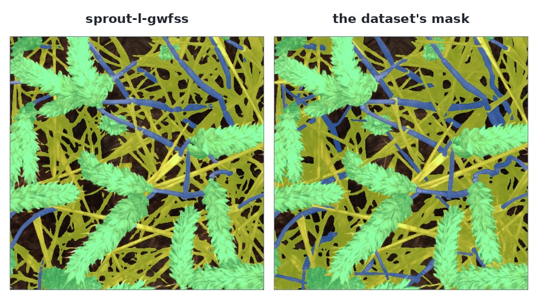

# `sprout-l-gwfss`

SPROUT-L is the laboratory's own foundation model for plant phenotyping: a 361 M parameter diffusion
model pretrained on 2.6 million unlabelled open-field photographs. This id is that model with a task
head fine-tuned on the [GWFSS](https://doi.org/10.1016/j.plaphe.2025.100084) training split. Send it a
wheat canopy and it answers the four organ classes in the dataset's own palette — `background`,
`head`, `stem`, `leaf` — in the object shape every model on this API answers in: one object per class,
COCO RLE, the colours the dataset itself uses.



It is the first member of the `SPROUT` family. A second head is in training; until it is served the
picker shows this id on its own rather than as a family.

**[Try it on the live demo](https://api.global-wheat.com/play?model=sprout-l-gwfss)** — the model is
already selected; pick `gwfss` row 4 and press Run.

## Parameters

<!-- parameters:start -->
This model declares **no parameters**: an image is the whole request, and a query string is refused rather than ignored.
<!-- parameters:end -->

## Where it works, and where it does not

This is the part worth reading before choosing it, because the answer is not about the model being
good or bad — it is about whether your picture is one it has ever seen.

The head was fine-tuned on 884 in-field photographs of wheat canopies: the GWFSS competition training
split, square frames, a camera positioned over the crop. That is the picture it answers.

| dataset | what it is | this model |
|---|---|---|
| `gwfss` | in-field canopy photographs, square frames, organ masks | its own domain — the pages below are measured here |
| `gwhd` | in-field canopy photographs, square frames, one box per head | the same kind of capture; it answers sensibly, but `gwhd` annotates boxes and no masks, so there is no score to give here |
| `gwhs` | a single wheat ear photographed on a desk, portrait crops | **out of domain** |

`gwhs` is out of domain twice over. It photographs one ear on a table rather than a canopy in a field,
and it appears nowhere in the training data. Its rows are also portrait frames — 247 to 1601 pixels
wide and 547 to 4263 tall — while this container resizes every input to a square, so a `gwhs` row is
stretched as well as being unfamiliar. Treat one as out of domain rather than as a hard case: if your
picture is a single ear on a bench, the model has nothing to say about it, and a whole-canopy answer
is not a wrong answer that better prompting fixes.

The rule is the same for your own photographs. A canopy shot framed the way `gwfss` is framed will
answer the way `gwfss` answers. A close-up of one organ, a picture taken at an angle from below, or a
portrait frame will not, and the square resize makes that worse rather than better.

## What comes back

One object per class that has pixels. Background is the complement and is not returned.

```json
{"model": "sprout-l-gwfss", "resolution_used": 512,
 "objects": [
   {"idx": 0, "category": "head", "bbox": [0, 0, 512, 512], "score": 0.902, "area": 86911.0,
    "rle": {"size": [512, 512], "counts": "…"}},
   {"idx": 1, "category": "stem", "bbox": [0, 0, 512, 512], "score": 0.790, "area": 16145.0,
    "rle": {"size": [512, 512], "counts": "…"}},
   {"idx": 2, "category": "leaf", "bbox": [0, 0, 512, 511], "score": 0.739, "area": 95280.0,
    "rle": {"size": [512, 512], "counts": "…"}}]}
```

Two fields are easy to read as more than they are:

- **`bbox` is the class's extent, not an object's box.** Heads scattered across the frame are one
  `head` object whose box is the whole frame. Counting them is a connected-component pass over the
  mask, not a count of objects.
- **`score` is the mean probability of that class over the pixels it owns** — derived, uncalibrated,
  and not comparable between classes.

## What it was measured at

Ten published `gwfss` rows, this container, a laboratory 3090:

| class | IoU |
|---|---|
| head | 0.885 |
| leaf | 0.832 |
| background | 0.761 |
| stem | 0.432 |
| **mIoU** | **0.7275** |
| pixel accuracy | 0.8905 |

Measured by this container's own `tests/bench.py`, which runs its `infer` and `outputs` over the ten
rows against the masks those rows publish, and is reproducible on any machine with the checkpoint.

**This is not a generalisation figure.** The ten rows are not a held-out set; the fine-tune's own
split is recorded (884 train, 99 validation, 110 test) but which of those contains the ten rows this
API publishes is not. The author's own evaluation is **78.80 % mIoU on validation and 75.10 % on
test**, over her 99 and 110 images. Those are her numbers on her split, quoted as hers.

One inference takes **287 ms** on the ten rows, and **318 ms** through `POST /predict` including the
image fetch. The process holds **2740 MiB** of the card.

## Size

`512` is the side the checkpoint's own inference script uses and this container reproduces it: your
image is resized to 512 × 512 — **square, without preserving the aspect ratio** — and the class map
comes back at your image's size. For a `gwfss` or `gwhd` row that resize is exact, because those
frames are already square; for anything else it is a distortion, and it is one of the reasons a
portrait `gwhs` row answers badly.

The network runs once per 256 × 256 window, four windows at stride 256, at a fixed timestep — the
author's validated protocol. There is no parameter to change the side, the window, or the scale, and
no query string is accepted at all.

## Where it comes from

Xiang, Burridge, Liu and Guo, *SPROUT: A Scalable Diffusion Foundation Model for Agricultural Vision*,
[arXiv 2603.27519](https://arxiv.org/abs/2603.27519). Code and the pretrained checkpoints are
[Apache-2.0](https://github.com/UTokyo-FieldPhenomics-Lab/SPROUT), and the licence travels with the
container.

The released pretrained weights carry no task head — the model is a denoiser, and each task's head is
created and trained separately. The segmentation head served here, and its checkpoint, were delivered
by the model's author; the container runs her own model code unchanged beside them. The id carries the
data it was trained on for that reason: a second head trained on other data is a second id, not a
variant of this one.
