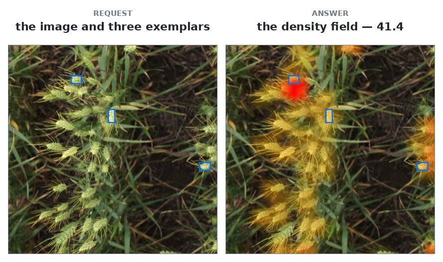

# `tasselnetv4`

TasselNetV4 — **counting**, not segmentation, from [the paper's own code and
checkpoint](https://arxiv.org/abs/2509.20857) (ISPRS J. Photogrammetry and Remote Sensing, 2025).
Show it a few examples of the thing you want counted and it answers **a number**, with the local-count
field that number is the sum of. It is class-agnostic: nothing in the container knows what a wheat
head looks like, so the request carries **exemplar boxes**, and three of them is the paper's setting.

## At a glance

| field | value |
|---|---|
| Task | class-agnostic counting from exemplar boxes |
| Input | a dataset image or upload, plus `boxes` |
| Output | `count`, and the `density` field it was summed from |
| Runs at | 384 px tall, tiled |
| Typical wait | 0.31 s |
| License | [Apache-2.0](#references) |



`gwhd` image 4 (`row` 4) with the live demo's three exemplars. The field sums to 41.4; the blue boxes
are the request, not detections.

**[Try it on the live demo](https://api.global-wheat.com/play?model=tasselnetv4)** — the model is
already selected; draw two or three boxes around heads on the picture and press Run. The `image` eye
turns the photograph off so the field is read on its own.

## When to use it

**Good at**

- Counting what you can show it two or three examples of, with no class list and no training.
- Cross-species counting: trained on PAC-105 and evaluated on PAC-Somalia, a set it has never seen.
- A fast answer over a whole picture, whatever its size: the frame is resized to 384 px tall.

**Not for**

- **A detector.** No box, no mask, no point, no per-object score. If you need to know *which* head is
  where, use [`gwfss-segformer-b4`](gwfss-segformer-b4.md) or [`sam3.1-meta`](sam3.1-meta.md).
- **A calibrated count across pictures.** Two calls on two photographs give counts on one scale, but a
  systematic offset on one species does not cancel on another.
- **A region counter.** `boxes` are exemplars, not a region of interest: there is no box or polygon
  that limits where it counts.

**Limits**

- `boxes` is required; without an example the request is a `400`.
- Every label must be `1`; extract-and-match has no negative exemplar, so a `0` is refused.
- An exemplar larger than the finest counting window is not refused: the model counts at its coarsest
  window and says so with `exemplar_clamped` in `warnings`.
- Nothing else is exposed: no threshold, no point count, no resolution parameter.

## Call it

With the client from [Clients](../api/clients/index.md) set up, or the `API` and `KEY` variables from [Raw HTTP](../api/http/index.md#five-calls):

=== "Python"

    ```python
    counted = client.predict(
        "tasselnetv4", "gwfss", 0,
        boxes=[[312, 143, 44, 55, 1]],
    )
    print(counted["count"])
    ```

=== "JavaScript"

    ```js
    const counted = await client.predict("tasselnetv4", "gwfss", 0, {
      boxes: [[312, 143, 44, 55, 1]],
    });
    console.log(counted.count);
    ```

=== "Java"

    ```java
    Map<String, Object> counted = client.predict("tasselnetv4", "gwfss", 0,
        Map.of("boxes", List.of(List.of(312, 143, 44, 55, 1))));
    ```

=== "HTTP"

    ```bash
    curl -s -H "X-API-Key: $KEY" -H "Content-Type: application/json" \
      -d '{"dataset": "gwfss", "row": 0}' \
      "$API/models/tasselnetv4/predict?boxes=[[312,143,44,55,1]]"
    ```

## Parameters

<!-- parameters:start -->
| parameter | default | accepts | what it does |
|---|---|---|---|
| `boxes` | — | `[[x, y, w, h, label], …]`, in the image's pixels | Exemplar boxes: one object of the kind to count, drawn. The model matches their appearance across the image, and three is the paper's setting. |
<!-- parameters:end -->

`boxes` is **required**: without an example the model has nothing to match, and the request is a
`400`. The label must be `1` — extract-and-match has no negative exemplar, so a `0` would be silently
ignored and is refused instead. The prompt is geometry in the image's own pixels; see
[Raw HTTP § Geometry](../api/http/index.md#geometry-boxes-and-points).

## What comes back

A count, and the field it was summed from. `objects` is present and empty, so one client parses this
answer and a segmenter's with the same code.

```json
{"model": "tasselnetv4", "resolution_used": 384,
 "objects": [],
 "count": 21.7,
 "density": {"size": [23, 23], "values": [0.041, 0.0, 1.284, "…"]}}
```

- **`count` is the answer.** It is a real number rather than a rounded one, because it is an integral
  of a field in which one cell can hold a fraction of an object.
- **`density` is that field**, on the model's own grid: `size` is `[rows, columns]`, `values` are the
  cells' local counts row by row, and they add up to `count`. A cell is a counting window, not a
  pixel — 17, 21 or 23 cells fill the 384-pixel-tall frame, depending on which of the model's three
  levels your exemplar's size selects. Draw it as a heatmap; `size` travels with the values because
  the grid is not always square.
- **There are no points and no instances.** The field says how much mass sits in a window; it does not
  say where one object ends and the next begins.

## Performance

### Quality

TasselNetV4 is trained on PAC-105 and evaluated on **PAC-Somalia**, a set of plant species it has never
seen: the paper reports **MAE 8.9** at three exemplars (10.98 at one). Through this container, on the
official test images and their official exemplar boxes:

| what | measured here | paper |
|---|---|---|
| `salaamuko`, all 48 images, official 3 exemplars | MAE **8.75** | 8.88 (3-shot) |
| 32 species, one image each, official 3 exemplars | MAE **10.8** | 8.88 (3-shot) |

So it is at its own level, not better. **The spread across species matters more than the mean**: on
`salaamuko` many images are annotated at 46–48 and answered at 58–66, about **+15%**, while other
species land within a few. A GWHD close-up of dense, small heads is further out still — that is a
different scene from the ones it was trained on, and it over-counts there.

### Speed

| what | measured on an RTX 3090 |
|---|---|
| one call through the API, from the gateway host | **0.31 s** |

The frame is resized to **384 px tall** and tiled, one tile at a time, so `resolution_used` is 384
whatever you send and a larger upload buys no resolution.

## References

- **Paper** — “TasselNetV4: A vision foundation model for cross-scene, cross-scale, and cross-species
  plant counting,” ISPRS J. Photogrammetry and Remote Sensing, 2025.
  [arXiv:2509.20857](https://arxiv.org/abs/2509.20857)
- **Code and weights** — [akaxiao/TasselNetV4](https://huggingface.co/akaxiao/TasselNetV4)
- **License** — [Apache-2.0](https://www.apache.org/licenses/LICENSE-2.0)
