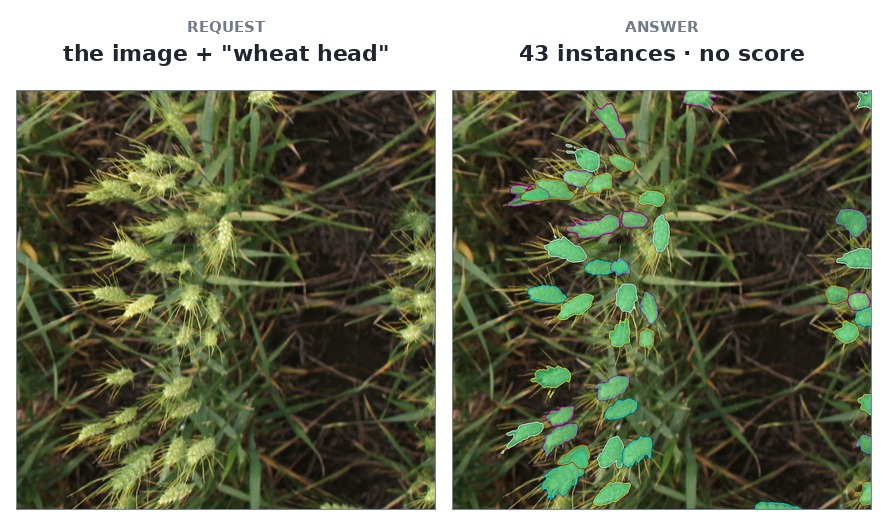

# `wevisone-vl-4b`

WeVisOne-VL-4B — **text in, instances out**, from [Tencent's own code and
checkpoint](https://github.com/Tencent/WeVisOne-VL). Say what to find — `wheat head`, `leaf`, `a
person` — and every instance of it comes back as a box **and a mask of its own**, at your image's own
resolution. It is open-vocabulary: the phrase you type is the class, and a frame with none of what you
asked for answers an empty list rather than an error.

## At a glance

| field | value |
|---|---|
| Task | open-vocabulary instance segmentation |
| Input | a dataset image or upload, plus `prompt` |
| Output | objects with `bbox` and a COCO RLE `mask`; no `score` |
| Runs at | your image's size, up to 4 MP; masks decoded at 1024 |
| Typical wait | about 25 s for forty instances |
| License | [Apache-2.0](#references) |



`gwhd` image 4 (`row` 4), `prompt="wheat head"`: 43 instances, each with its own mask and no score.

**[Try it on the live demo](https://api.global-wheat.com/play?model=wevisone-vl-4b)** — the model is
already selected; type what to look for, or press one of the two example chips.

## When to use it

**Good at**

- A single phrase that names what you want, with one mask per instance.
- Dense, overlapping objects: a close-up frame with about forty awned heads came back as 43 separate
  masks, each following its own head rather than merging into one blob.
- Your image's own resolution, up to four megapixels.

**Not for**

- **Thresholding.** There is no `score`; the model either names an object or answers nothing. Its own
  judgement is the whole filter, so a caller accepts every instance or none.
- **Two classes at once.** One phrase per request; a second class is a second call.
- **A quick answer.** About 25 seconds for forty instances, proportional to how many it finds, and it
  holds one of your three inferences for that long.
- **A wheat-specific guarantee.** It is a general referring-segmentation model. Recognising `wheat
  head` on one frame class is a measurement, not a promise across growth stages, lighting or `gwhs`
  desk photographs.

**Limits**

- `prompt` is at most 120 characters.
- At most 100 instances per call; past that it stops looking.
- An upload is capped at four megapixels. The pixel decoder produces one map per instance at your
  size, so a larger frame is what makes the container's memory grow, not the instance count.
- With no `score`, a frame that contains nothing you asked for answers an empty list.

**Compared with `sam3.1-meta`**

[`sam3.1-meta`](sam3.1-meta.md) runs the picture at a fixed 1008-pixel square and answers masks from
its own detector. This model keeps your image's own resolution (up to four megapixels), writes a box
per instance as text, and decodes each mask on a 1024 square before upsampling it to your size. It
also reports no score.

## Call it

With the client from [Clients](../api/clients/index.md) set up, or the `API` and `KEY` variables from [Raw HTTP](../api/http/index.md#five-calls):

=== "Python"

    ```python
    answer = client.predict(
        "wevisone-vl-4b", "gwhs-temp", 0,
        prompt="wheat head",
    )
    ```

=== "JavaScript"

    ```js
    const answer = await client.predict("wevisone-vl-4b", "gwhs-temp", 0, {
      prompt: "wheat head",
    });
    ```

=== "Java"

    ```java
    Map<String, Object> answer = client.predict(
        "wevisone-vl-4b", "gwhs-temp", 0,
        Map.of("prompt", "wheat head"));
    ```

=== "HTTP"

    ```bash
    curl -s -H "X-API-Key: $KEY" -H "Content-Type: application/json" \
      -d '{"dataset": "gwhs-temp", "row": 0}' \
      "$API/models/wevisone-vl-4b/predict?prompt=wheat%20head"
    ```

## Parameters

<!-- parameters:start -->
| parameter | default | accepts | what it does |
|---|---|---|---|
| `prompt` | — | text, at most 120 characters | What to find, in words: a class name or a phrase, e.g. 'wheat head'. Every object in the answer is one instance of it, and a frame with none answers an empty list. |
| `max_instances` | `64` | `1` – `100` | How many instances to answer. It is the wait as much as the count: each one costs about half a second, and the model stops looking at this number. |
<!-- parameters:end -->

`prompt` is **required**: this model has no default class, and an empty phrase would ask for
"something". Tencent's own package calls it `query`; this contract calls it `prompt`, like every other
model here that takes text, so one script can point at two models by changing the id.

`max_instances` is the wait as much as the count — the model writes one six-token box per instance and
decodes a mask for each, so **sixty instances is about half a minute** and one is a few seconds. It
stops looking at that number rather than generating more and dropping the rest.

## What comes back

One object per instance, in the same shape a dataset's annotations arrive in:

```json
{"model": "wevisone-vl-4b", "resolution_used": 1024,
 "objects": [{"idx": 0, "category": "wheat head",
              "bbox": [148.5, 809.0, 72.7, 47.1], "area": 2463.0,
              "rle": {"size": [1024, 1024], "counts": "…"}}],
 "computed_by": {"machine": "dgx-v100", "gpu": "Tesla V100-DGXS-32GB",
                 "compute_capability": "7.0", "dtype": "float16", "…": "…"}}
```

- **There is no `score`.** The model either names an object or answers `None` for a target it cannot
  find; it publishes no per-instance confidence.
- **`category` is your prompt**, because that is the class: two calls on one frame with different
  phrases are two different questions.
- **`rle` is COCO's compressed counts**, decoded by the same client code a dataset's geometry is.
  `area` is there so a decoder can be checked against one number.
- **`resolution_used` is the canvas the masks were decoded on** (1024), not the size you sent: the
  pixel decoder refines on a fixed square and the answer is upsampled to your image.

## Performance

### Quality

On a close-up frame with about forty heads, overlapping and awned, it found 43 instances and every
mask followed its own head — separate masks through a cluster, awns cut off, no merging into one blob.
Two calls on one frame with different phrases are two different answers: ask for `leaf` and the same
machinery returns leaves.

### Speed

About 25 seconds for forty instances, proportional to how many it finds. One instance is a few
seconds; the declaration gives the model 90 seconds rather than the default ten.

## References

- **Paper** — Liang et al., “WeVisOne-VL: Unified Visual Perception from Objects to Pixels,”
  arXiv 2026. [arXiv:2610.31329](https://arxiv.org/abs/2610.31329)
- **Code** — [Tencent/WeVisOne-VL](https://github.com/Tencent/WeVisOne-VL)
- **Weights** — [tencent/WeVisOne-VL-4B](https://huggingface.co/tencent/WeVisOne-VL-4B)
- **License** — [Apache-2.0](https://github.com/Tencent/WeVisOne-VL/blob/main/LICENSE)
