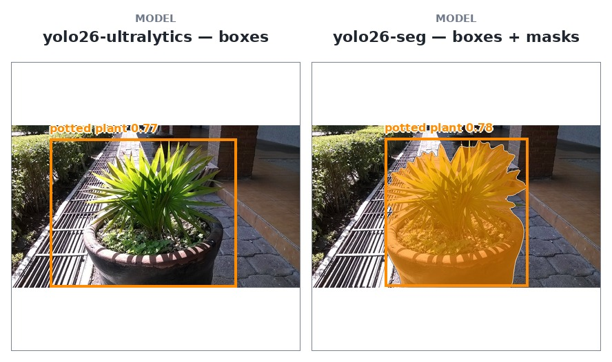

# YOLO26

<!-- models: yolo26-ultralytics yolo26-seg-ultralytics -->

Two checkpoints from [Ultralytics](https://docs.ultralytics.com/models/yolo26/), served as one
family: **`yolo26-ultralytics`** answers boxes, and **`yolo26-seg-ultralytics`** answers the same boxes
plus a mask per object. Both are the COCO models as Ultralytics publishes them, and they are the
fastest models this API serves — one call is a few milliseconds.

## At a glance

| field | value |
|---|---|
| Task | COCO object detection, or instance segmentation with the seg id |
| Input | a dataset image or upload |
| Output | `objects` with `bbox` and `score`; the seg id adds a COCO `rle` mask |
| Runs at | 640 / 1024 / 1280 px square; default 1280 |
| Typical wait | 6–15 ms |
| License | [AGPL-3.0](#references) |



`dev/potted-plant.jpg` (CC0, Wikimedia Commons), `imgsz=1024`, `confidence_threshold=0.25`:
`yolo26-ultralytics` and `yolo26-seg-ultralytics` on the same photograph. COCO's classes do not
include wheat, which is why this page uses a photograph they do know.

### The two ids

| property | `yolo26-ultralytics` | `yolo26-seg-ultralytics` |
|---|---|---|
| one object is | a box and a class | a box, a class and a mask, as COCO RLE |
| trained on | COCO's 80 classes | the same 80 classes, with instance masks |
| an upload may be | 50 megapixels | 4 megapixels, and at most 100 objects back |
| one 1024² call | 7.1 ms | 9.3 ms |

**[Try v26](https://api.global-wheat.com/play?model=yolo26-ultralytics)** — the picker groups the two
under **YOLO**, and the second control chooses the one with the mask head.

## When to use it

**Good at**

- The 80 COCO classes: people, vehicles, animals, vegetables, pots and plants.
- A fast box answer, or the same boxes with an instance mask each.
- Looping over many pictures: a call is milliseconds, not seconds.

**Not for**

- **Wheat.** COCO's 80 classes do not include a wheat head, and a `gwhd` image answers zero objects from
  both ids — not a low score, an empty list. That is the honest answer from a general detector; use
  [`sam3.1-meta`](sam3.1-meta.md) when you can name what to look for.
- **The organ map.** [`gwfss-segformer-b4`](gwfss-segformer-b4.md) answers one extent per class — every
  head pixel, every stem pixel. The seg id answers separate objects, each with its own mask.
- **A wheat fine-tune.** A fine-tune would be an id of its own, named after the data it learned from.

**Limits**

- The mask id admits a 4 MP upload and at most 100 objects; the box id admits 50 MP. A larger mask
  upload is refused with a `400` naming the limit.
- `imgsz` accepts 640, 1024 or 1280; a larger value runs at 1280 with a warning.
- The checkpoints are not trained on wheat, so a wheat photograph is not a domain you can fix with a
  threshold.

**When to run it yourself**

The checkpoints are public and Ultralytics' own, so a fine-tune of your own is a path on your machine
rather than an id to ask us for. The [datasets](../datasets/gwhd.md) are public, the annotation format
is [one decoder](../api/clients/index.md) in all three clients, and `GLOBAL_WHEAT_API` points a client
at a host of your own.

## Call it

With the client from [Clients](../api/clients/index.md) set up, or the `API` and `KEY` variables from [Raw HTTP](../api/http/index.md#five-calls):

=== "Python"

    ```python
    answer = client.predict_file("yolo26-ultralytics", "photo.jpg")
    ```

=== "JavaScript"

    ```js
    const answer = await client.predict_file("yolo26-ultralytics", file);
    ```

=== "Java"

    ```java
    Map<String, Object> answer = client.predict_file(
        "yolo26-ultralytics", new java.io.File("photo.jpg"), Map.of(), true);
    ```

=== "HTTP"

    ```bash
    curl -s -H "X-API-Key: $KEY" -F "file=@photo.jpg" \
      "$API/models/yolo26-ultralytics/predict/upload"
    ```

The same call with `yolo26-seg-ultralytics` returns a mask beside each box.

## Parameters

Both ids answer the same two parameters, and they ride in the **query string** beside the address:

### `yolo26-ultralytics`

<!-- parameters:yolo26-ultralytics:start -->
| parameter | default | accepts | what it does |
|---|---|---|---|
| `confidence_threshold` | `0.25` | `0` – `1` | How sure the model must be before it reports an object. |
| `imgsz` | `1280` | `640`, `1024`, `1280`; a larger value runs at `1280` | The square side the network runs at. A smaller one is faster and worse on small objects; a larger one runs at the ceiling and says so in `warnings`. |
<!-- parameters:yolo26-ultralytics:end -->

### `yolo26-seg-ultralytics`

<!-- parameters:yolo26-seg-ultralytics:start -->
| parameter | default | accepts | what it does |
|---|---|---|---|
| `confidence_threshold` | `0.25` | `0` – `1` | How sure the model must be before it reports an object. |
| `imgsz` | `1280` | `640`, `1024`, `1280`; a larger value runs at `1280` | The square side the network runs at. A smaller one is faster and worse on small objects; a larger one runs at the ceiling and says so in `warnings`. |
<!-- parameters:yolo26-seg-ultralytics:end -->

`imgsz` is the square side the network runs at, and the three values are the ones this deployment
measured. A larger value is not an error: it runs at `1280` and says so in `warnings`. A smaller one is
faster and worse on small objects.

`confidence_threshold` is the same name and the same bounds every object-answering model here
publishes, so a caller that lowers it for `sam3.1-meta` lowers the same knob here.


## Using it

### The three example photographs

COCO's classes are not in `gwhd`, so the playground's chips for this family do something the others do
not: they upload a picture instead of naming a dataset image. The pictures are chosen for classes these
checkpoints actually know — **carrots**, **broccoli** and **a potted plant**. They live under the data
distribution's `dev/` prefix, and the playground asks this API for them, which reads the object once
and answers it from here — a browser cannot read another origin's bytes to upload them:

| example | picture | licence |
|---|---|---|
| carrots | [`dev/carrot.jpg`](https://data.global-wheat.com/dev/carrot.jpg) | public domain, Wikimedia Commons |
| broccoli | [`dev/broccoli.jpg`](https://data.global-wheat.com/dev/broccoli.jpg) | CC0, Wikimedia Commons |
| a potted plant | [`dev/potted-plant.jpg`](https://data.global-wheat.com/dev/potted-plant.jpg) | CC0, Wikimedia Commons |

They are a demonstration and nothing else: the same call on a `gwhd` image answers an empty list, and
that is the honest answer from a model that has never seen a wheat head.

## What comes back

`yolo26-ultralytics` answers one object per detection: `category`, `score` and `bbox` in the picture's
own pixels. `yolo26-seg-ultralytics` answers the same objects and adds a COCO `rle` mask to each.
`objects` is empty when the picture holds nothing the checkpoint knows — on a `gwhd` image, that is both
ids' answer. The rest of the envelope is the shared one: `resolution_used` and `computed_by`.


## Performance

### Speed

Through the containers' own code, on `gwhd` images, ten timed calls each after a warm-up pass:

| `imgsz` | `yolo26-ultralytics` | `yolo26-seg-ultralytics` |
|---|---|---|
| `640` | 6.3 ms | 7.7 ms |
| `1024` | 7.1 ms | 9.3 ms |
| `1280` | 12.1 ms | 15.1 ms |

Both are fast enough to loop over images without thinking about it; the mask head costs a few
milliseconds more, and a 4-megapixel upload with 100 objects is the slowest request it admits.

## References

- **Paper** — Jocher et al., “Ultralytics YOLO26: Unified Real-Time End-to-End Vision Models,”
  arXiv 2026. [arXiv:2606.03748](https://arxiv.org/abs/2606.03748)
- **Code** — [ultralytics/ultralytics](https://github.com/ultralytics/ultralytics)
- **Weights** — [Ultralytics/YOLO26](https://huggingface.co/Ultralytics/YOLO26)
- **License** — [AGPL-3.0](https://github.com/ultralytics/ultralytics/blob/main/LICENSE)
